# Week 05 - Consistency

[Drehbuch](https://sgi.pages.fhnw.ch/moduluebersicht/2026hs/sysd/drehbuch.html)
[Aufgaben](https://spd.pages.fhnw.ch/module/sysd/assignments/system-design/index.html)

## Introduction –Challenges with consistency

- 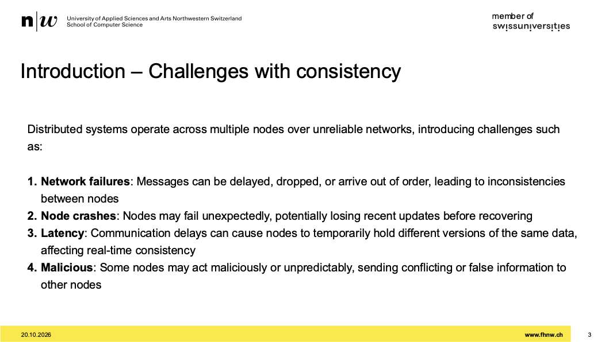
- 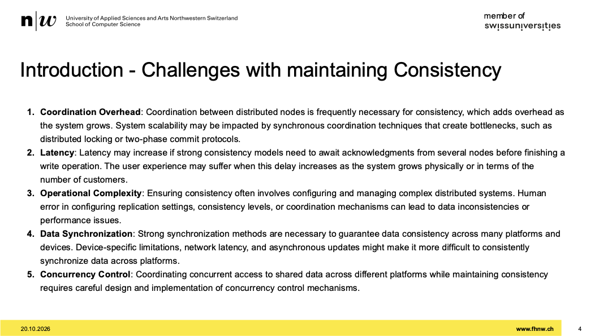
- bei verteilen system problem von network failure
- nodes crashes: tagesordnung, das sie crashen oder maintenance gemacht wird
- latenz: langsam aber konsistenz
- malicious: manche nodes machen komisches zeug, malicious sachen

1. koordination overhead
2. latenz wegen konsistenz
3. operationale konsistenz
4. daten synchronisation
5. kontrolle über konsistenz

- das sind herausforderungen die wir lösen wollen, angehen wollen
- nie alles lösbar
- wo gehen wir trade-off ein

## Enter the CAP theorem

- altes theorem
- immer maximal zwei entscheiden
- man schafft nie alle drei
- availability heisst alle verfügbaren systeme sind erreichbar
- das p ist wichtig, dass ist quasi ausfall tolerant und p ist eigentlich immer gegeben, da es immer einen ausfall haben kann
- wenn jetzt p eintrifft, ein ausfall, dann wählt man zwischen consitency odr availability
- wenn ich c auswähle, dann müsste ich beim einten system angeben, dass wenn es einen ausfall gibt, er eine meldung schciken soll wie "momentan nicht verfügbar, odr momentan keine daten"
- wenn ich a auswähle, dann liefert das system daten, aber ich kann nicht garantieren, dass die daten auf allen systemen die selbe sind
- man hat immer einen latency trade-off

## CAP theorem and latency trade-off

- 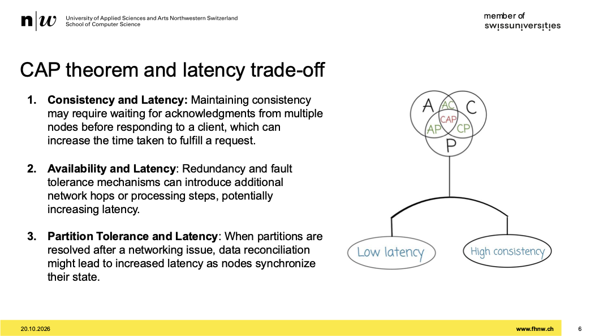
- je mehr systeme umso mehr latenz (C)
- bei P genauso, mehr latenz um es wieder C zu machen

## PACELC –what if there is no network partition

- 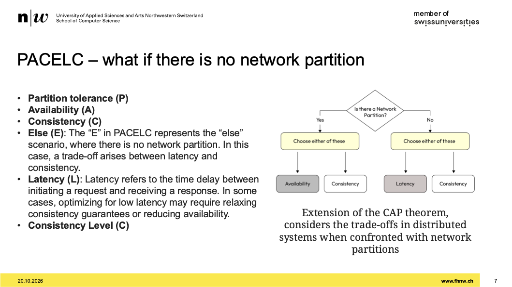
- wenn es eine P gibt, dann entscheidet man sich zwischen A und C
- wenn keine C da ist, entscheidet man isch oft zwishcen latenz und C
- das sagt dieses Theorem

## Seeking real-world examples

- Bank wählt C
- Straming dienste, messengers wählen A

## Typical DB examples <

- jede db kann man in verschiedene modis konfigurieren
- bsp. aus der praxix:
  - bundesverwaltung hat zwei datenbanken
  - keine synchro dazwischen
  - auch hier, in der heutigen tools, können wir CAP nicht haben, wir müssen zwischen CP und CP wählen
  - bei der datenbankanbindung auswählen, was wir priorisieren

## The Byzantine generals problem - BGP

- 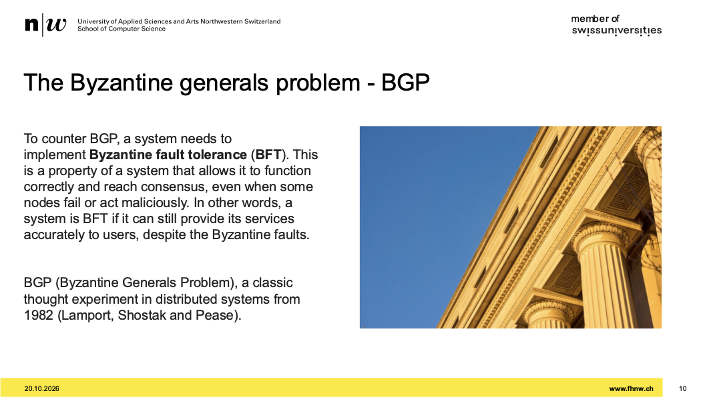
- 1982 gab es das probem schon
- ein theoretisches problem
- stadt wird belagert, von verschiedenen herrschern
- zum synchronisieren haben sie meldeläufer
- es geht darum wann sie loslaufen etc. um etwas zu melden
- ein systembaue das BFT ist (Byzantine fault tolerance)
- bekannte systeme die das umsetzen:
  - bitcoin
  - bei einem fehler, wird system sofort ausgeschlossen

## Consistency ≠ Consistency

- C nicht gleich C
- wir können entschieden wie mit C umgehen
- es gibt verschiedene stufen
- Eventual Consistency–Updates will propagate eventually, no guarantees on order or timing.
  - keine garantie ob es C ist
- Causal Consistency–Operations that are causally related are seen in order, unrelated ops may vary.
  - die wichtigen operatoren müssen in order sein
  - bsp. ein chat message
  - mein chat soll alle in korrekter order haben, aber der chat meines gegenüber
- Sequential Consistency–All nodes see operations in the same order, but not necessarily real-time.
  - alles node sehen alle messages aber nicht zur gleichen zeit
- Strong Consistency (also called linearizability) –Every read sees the most recent write instantly, like a single system.

## Consistency

- 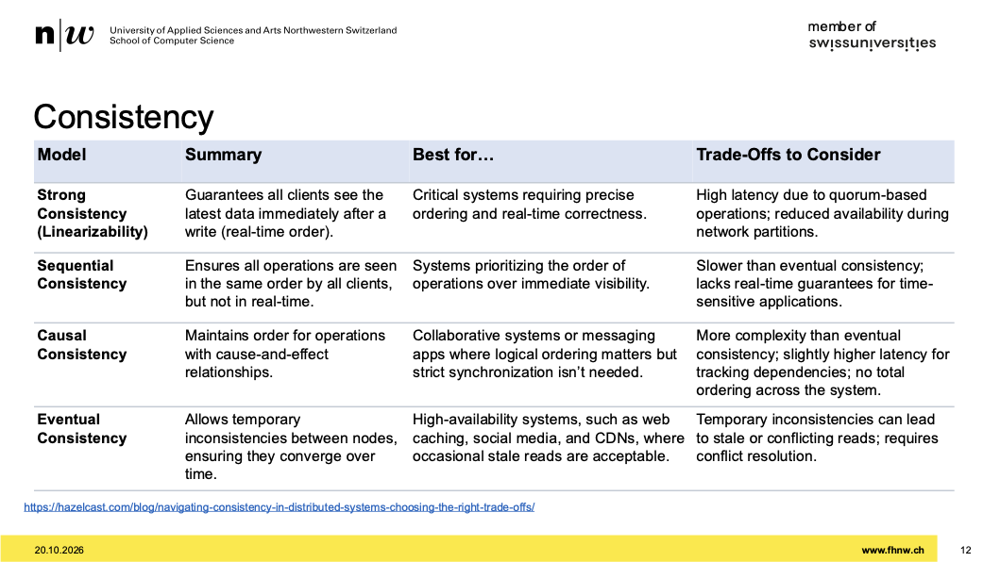

## Techniques to achieve consistency

- wie erreiche strong:
  - Consensus Algorithms:
    - etcd hat das
    - sprechen darüber, wer ist der leader
  - Synchronous Replication_
    - gleichzeitiges replizieren
  - Distributed Transactions:
    - warten bis transaktion zurück kommt, vorher passiert nichts
- wie erreiche eventual:
  - Asynchronous Replication:
    - es gibt ein window wo es kurze zeit nicht C ist
  - Gossip Protocols:
    - node sprechen ab und zu miteinander, um vielliecht irgendwann C zu sein
  - Conflict Resolution:
    - strategien definieren, wenn es zum konflikt kommt
    - last write win ...
- 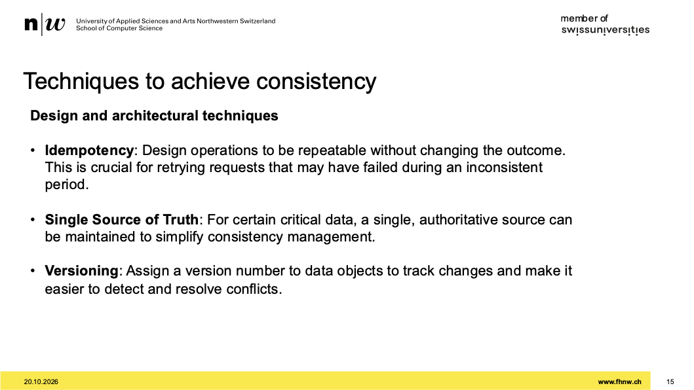
- 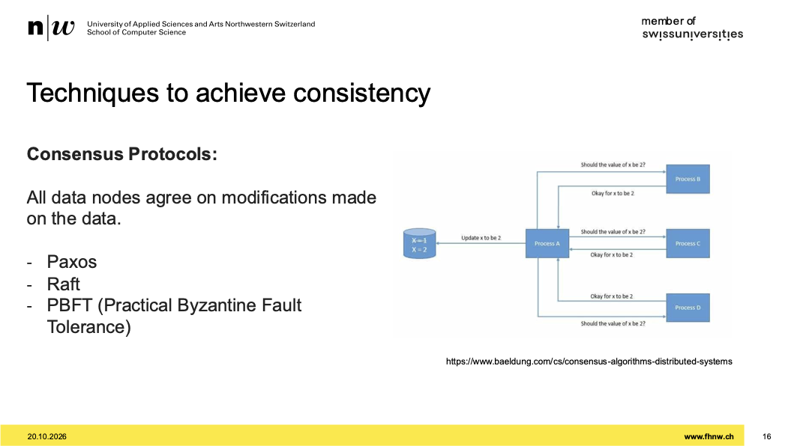
- Quorum:
  - für strong kann man das nutzen
  - immer ungerade zahl nehmen
  - damit entschieden werden kann, welche state der korrekte ist
- 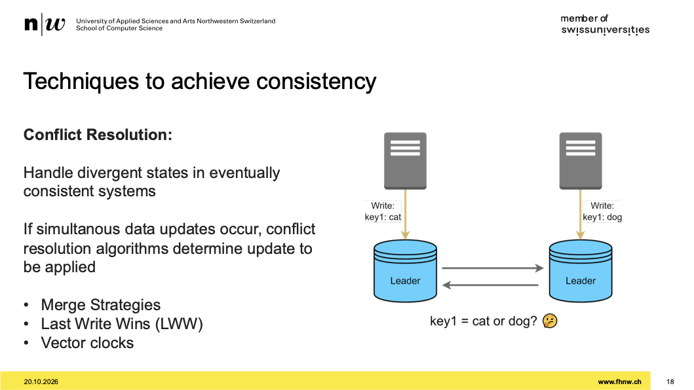

## Wrap-up: why do we need consensus

- 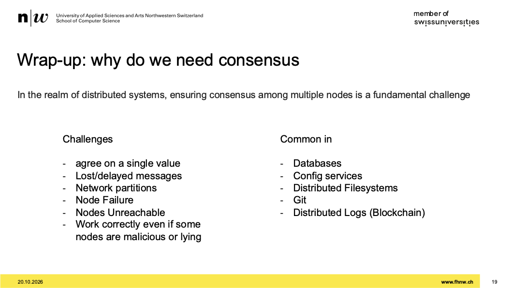

## Considering RTO and RPO in case of a disaster

- RTO: maximale zeit wo ein system offline sein darf
- RPO: wie viel datenverlust akzeptiere ich von einem system
- bei strong: RPO = 0

## Latency and Availability trade-off in a practical example

- zweite DB einführen, wegen A
- C eigebaut
- das sind dann 4x latenz
- 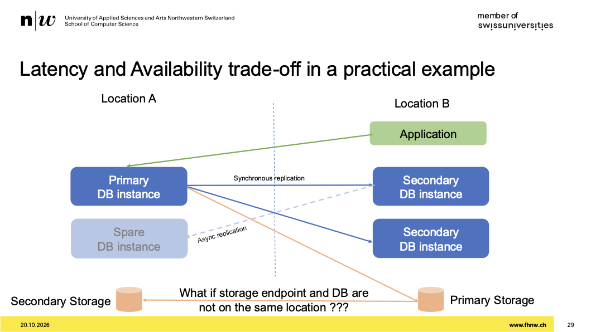
- Postfinance hatte das
- als sie von monolith zu micro gewechselt sind
- für prüfung, an der letzten:
  - sie fragen sahcen wie: wir haben verteilt und wollen C haben, wie machen wir das
  - dann wird gefragt, was passiert wenn ein link down geht
  - ich habe eine RTO von 15 min, dann löse ich das mit asynchrone replikation

---

# Persistence

## Databases

- wir machen es mit storage von azure
- wir schauen es konzeptioneller an
- verschiedene db typen
- relational, key-value, document oriented, graph
- 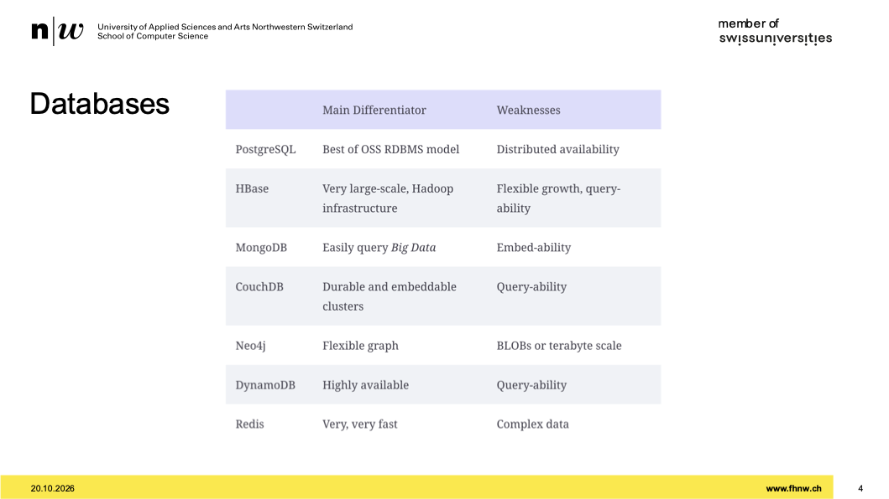
- früher die bekannten marken in unternehmen

## Most popular databases

- oracle immernoch platz 1
- databricks:
  - S3 storage unten dran
  - arbeiten mit files

## Block Storage (BS)

- was für storage brauche ich für ein system?
- file, block odr was?
- mit welchen k8s boardmitteln
- eine harddisk, in ein system rein schraubt, ist das block storage
- zum brauchen brauchen wir ein filesystem drauf
- remote bs via iSCSI oder fibre channel

## File Storage

- POSIX compliant filesystem
- 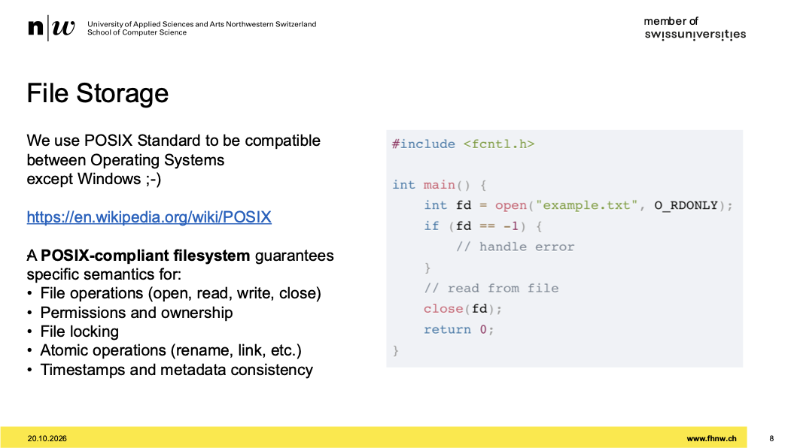

## Distributed File Storage

- 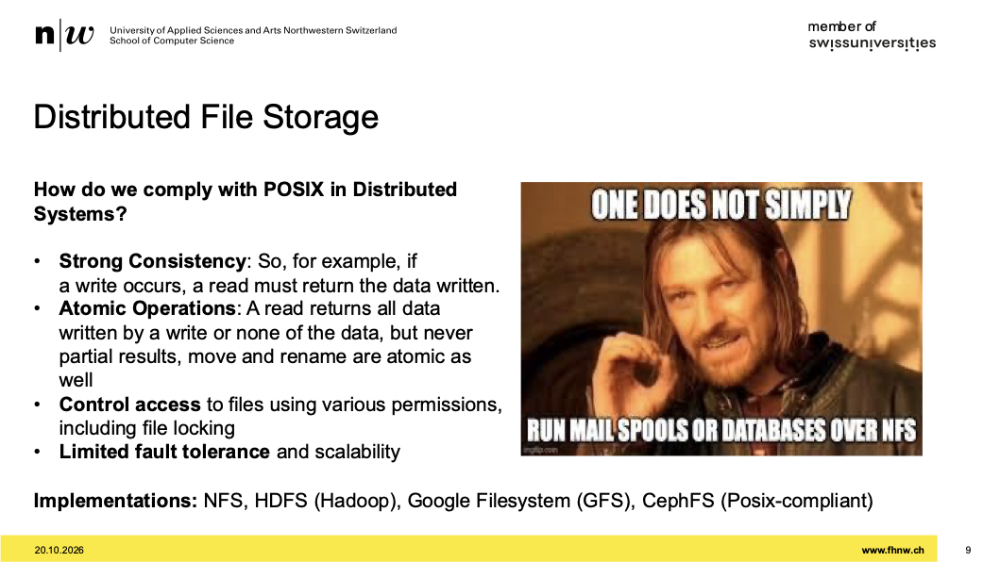

## Blob Storage

- ein storage der immer mehr verwendet wird
- vorallem bei analytischen apps
- unendlich platz
- hoch verfügbar
- es ist aber eventually consistent
- kommt im bereich von http
- funktioniert mit put und delete
- nicht POSIX compliant
- move und copy können teuer werden
- S3 ist kein standard
- 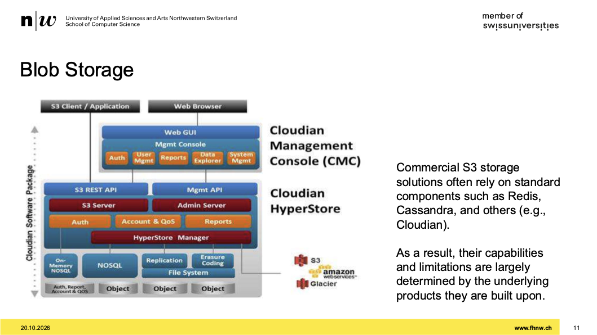

## Replication & Consistency

- bei nfs hat man üblicherweise einen eintrittspunkt

## Wrap-Up'

- 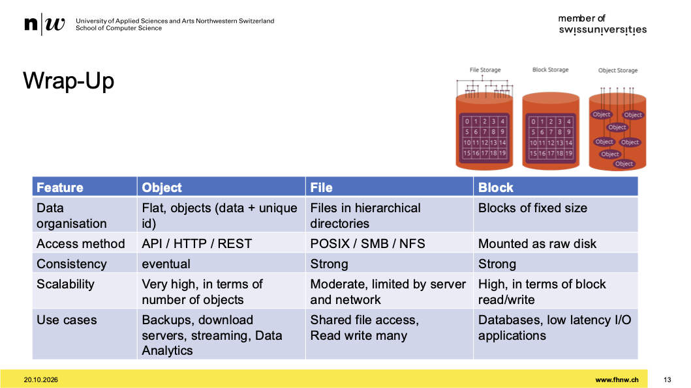

## Integrating Persistence in Kubernetes

- 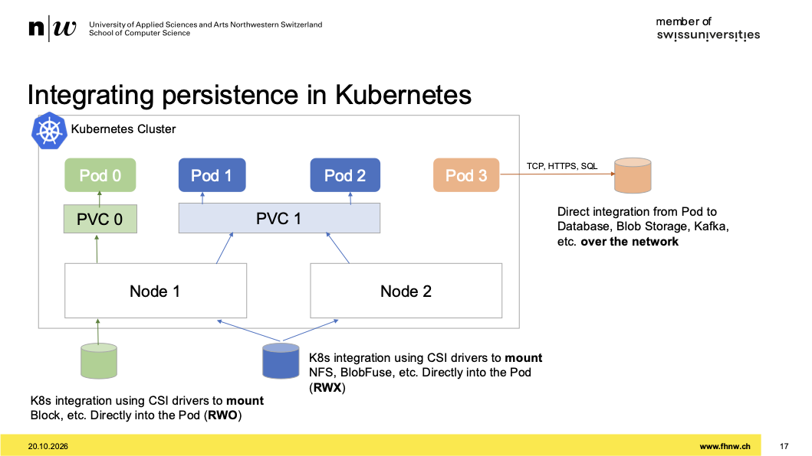
- storage integrieren
- wie mache ich meine persistenz
- gedanken über unsere chatbots machen
- azure disks, files odr blob anhängen
- von azure aus, in k8s nicht von haus aus verfügbar
- dann in k8s ein PVC machen, mit die und die eigenschaft und den dann an pod mounten
- chat messages auf storage schreiben
- lokal reduntand, oder geo reduntand
- überlegen, was mit RTO und RPO passiert
- ist es synchron, odr asynchron
- das sind gedanken die wir machen müssen über unsere chatbots

## Integrate into Kubernetes

- 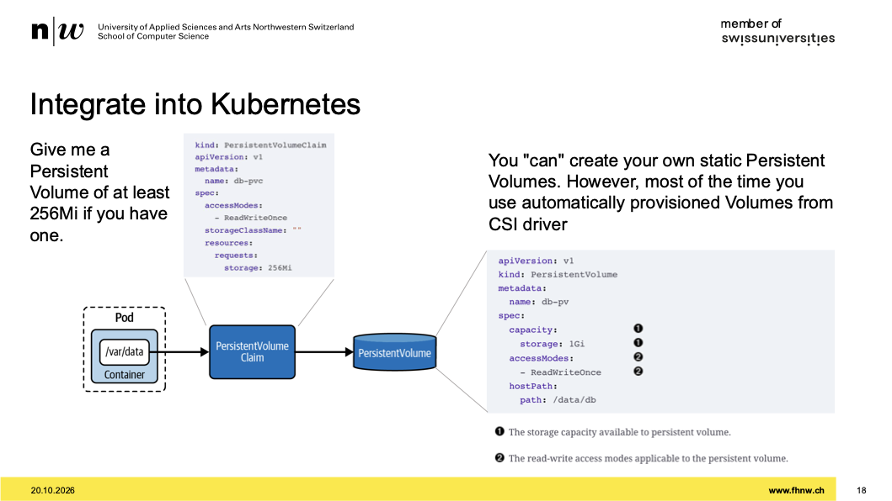
- 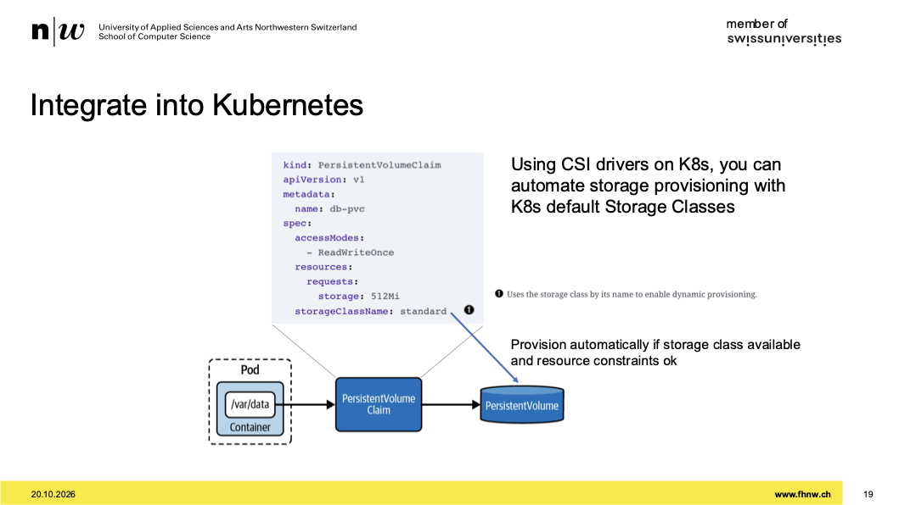
- 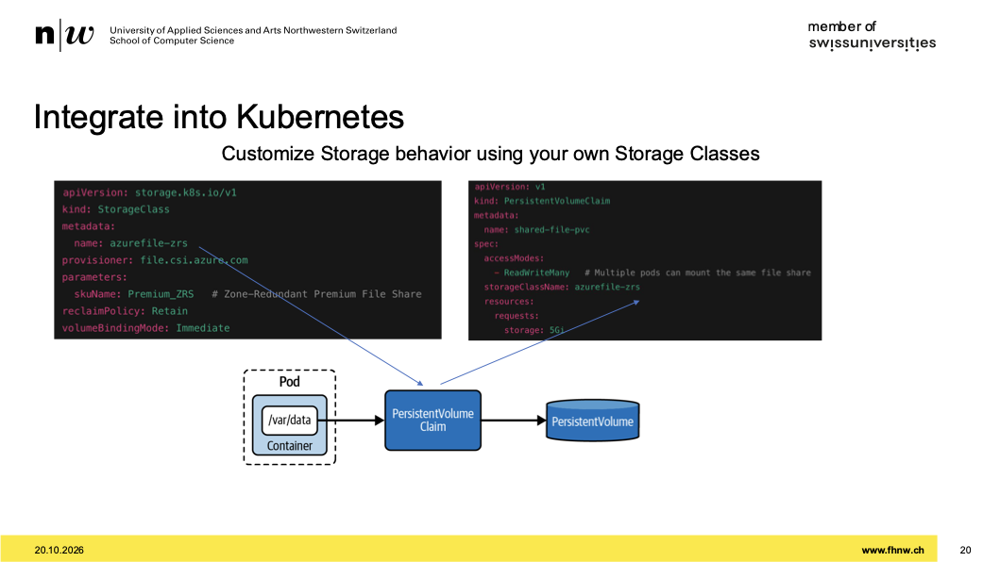
- für unsere übung müssen wir wahrsch. eine storge class anlegen und sagen welche wir verwenden wollen
- ein PVC ohne eigene class nimmt ein eigenes
- ansonsten angeben, welche wir verwenden wollen
- bei azure immer über storage class
- nsf ist nicht so performant, mit vielen kleinen files
- reclaim policiy gibt es verschiedene einstellungen: delete, retain
- 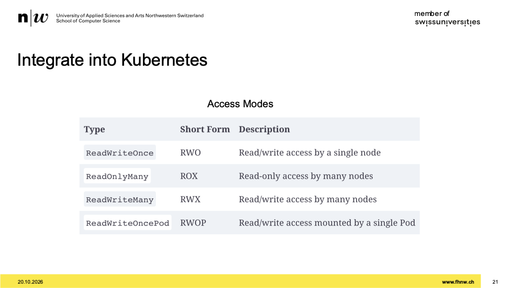
- wird es synchron repliziert
- gibt es eine RTO?

## Integrate into Azure AKS - DEMO

## Integrate into Azure AKS

## Wrap-up''

- 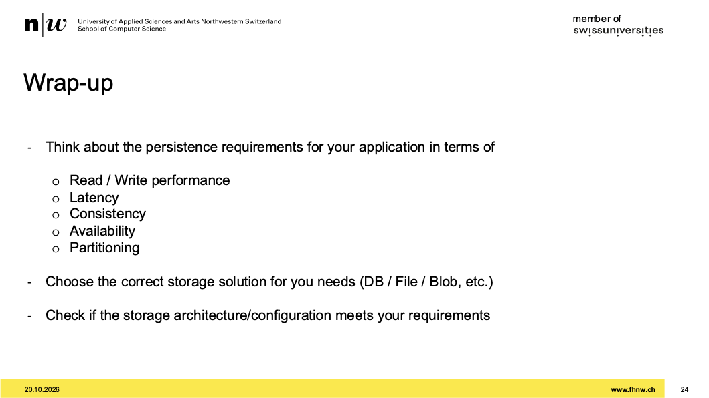

---

## Assessment 05

- part 1:
  - algo auswählen und vorbereiten
  - in md machen und gemeinsam besprechen in prüfung
- part 2:
  - mit db auseinandersetzen
  - vorteile nachteiel für unseren use case auswählen
- part 3:
  - persistenz in unserer app einbauen
