# Week 07 - Consistency: Distributed Caching

[Drehbuch](https://sgi.pages.fhnw.ch/moduluebersicht/2026hs/sysd/drehbuch.html)
[Aufgaben](https://spd.pages.fhnw.ch/module/sysd/assignments/system-design/index.html)

---

## Assessment 07 (Recap)

- single reciveier pattern hat seb gemacht
- auf nats queue geschrieben with jetstream
- wenn msg von reciveier gelesen wird, wird sie dann gelöscht
- nats box ist nur tooling, mit deployment
- nats ist dann ein statefulset
- ein pvc wird erstellt
- nats values verwendet mit chart
- eine konsumergruppe an subject machen im gleichen broker
- jetstream ist broker
- filestore.enabled = true
- workqueue mit readonce und so
- solange nicht gelesen, wird sie persistiert
- cw baut config auf
- eliza hängt sich an subject an
- wichtig wenn wir so etwas bauen, schauen was echt unter dem pvc steckt

---

## Intro

- 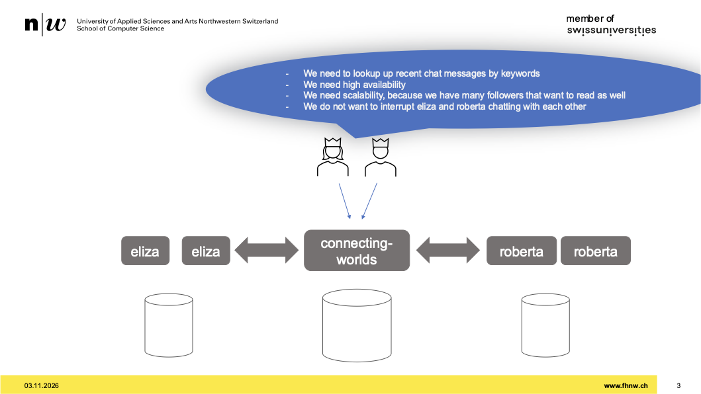
- user die msg nach keyowrds suchen wollen
- auch wenn cw neustartet
- es muss skalieren
- die bots nicht beeinträchtigen bei vielen usern
- 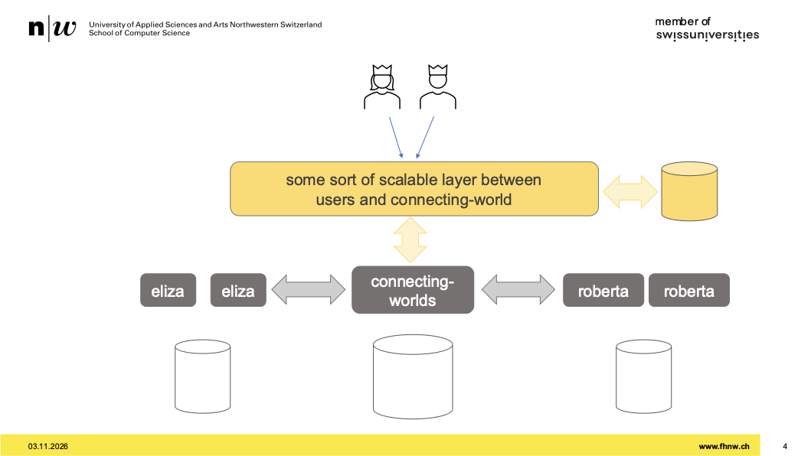
- wir veruschen eine entkoppelung zu erhalten
- auf einem layer, der alles cached
- woher kommt die überlegung aus der praxix:
  - eine bank
  - web, app, kartenzahlung, core-banken-system
  - entkoppeln infos von einandern (core-system und icons)
  - durch verschiedene layern, zum beispiel caching layern
  - man hat verschiedene tools probiert
  - postgre, verschiedene elastic lösungen
- 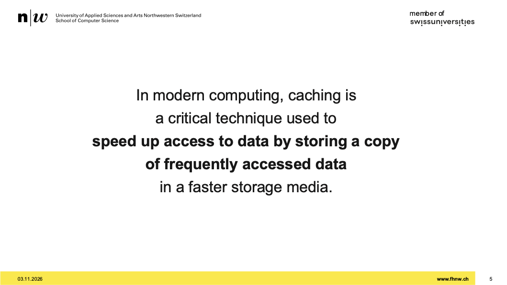
- häufige anfragen gecached

## Introduction

- 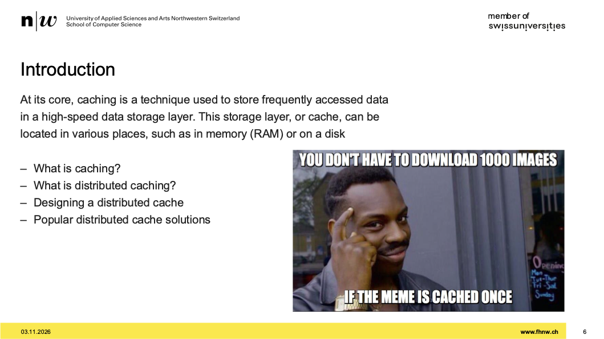

## Why do we need a cache (box)?

## Use cases

- 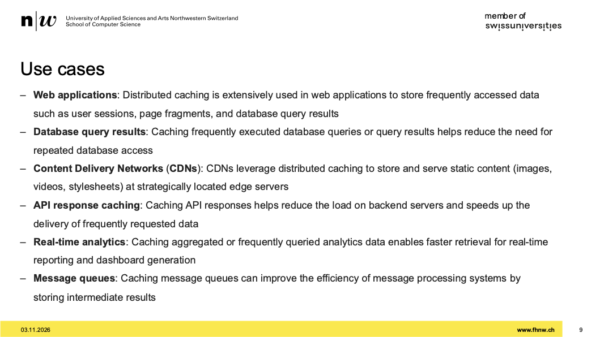
- bei db:
  - last durch user
  - db merkt, die user haben immer gleiche infos, egal wie viel es davon sind

## Use cases – CDN

- traffic und content über grosse distanz schnell anzeigen, liefern

## Use cases – client/server based

- 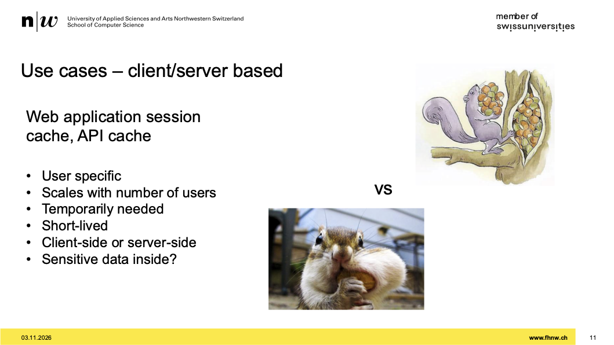
- häufig eine cachemethode user basierend sind
- aufpassen, was im cache liegt
- umgang mit daten, kann heikel werden
- aufpassen wo dann die daten liegen, auf cacheserver die nicht in unserer hand liegen
- besser serverseitig cachen und shortlived machen

## Importance of caching?

## Benefits

- 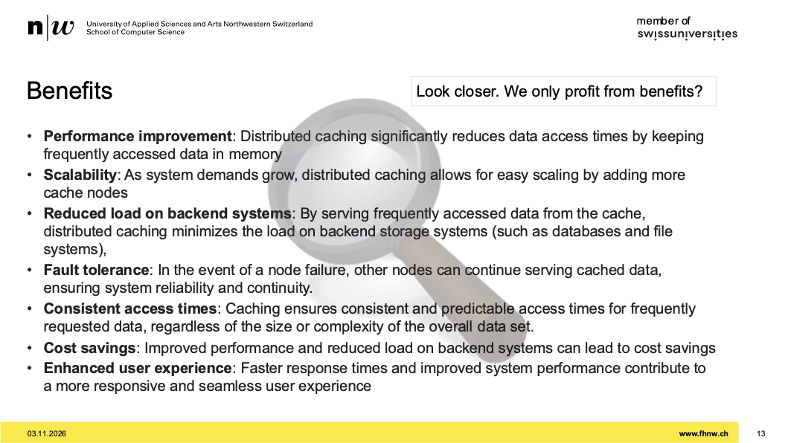
- caching in cw einbauen, dann viel schneller
- systeme entlasten
- ausfalltoleranz, HA machen
- konsistenze accesstime machen unabhängig wie hoch der load ist
- cost savings
- mehr ux
- wieso nicht einfach alles cachen?
  - consistency
  - cache invalidation complexity
  - mehr complexity
  - networking overhead
  - potential for cache staleness
  - data partizionierug
  - high memory usage
  - costs
  - data access patterns
  - limited utility for write-intensive workloads

## Design decisions

- 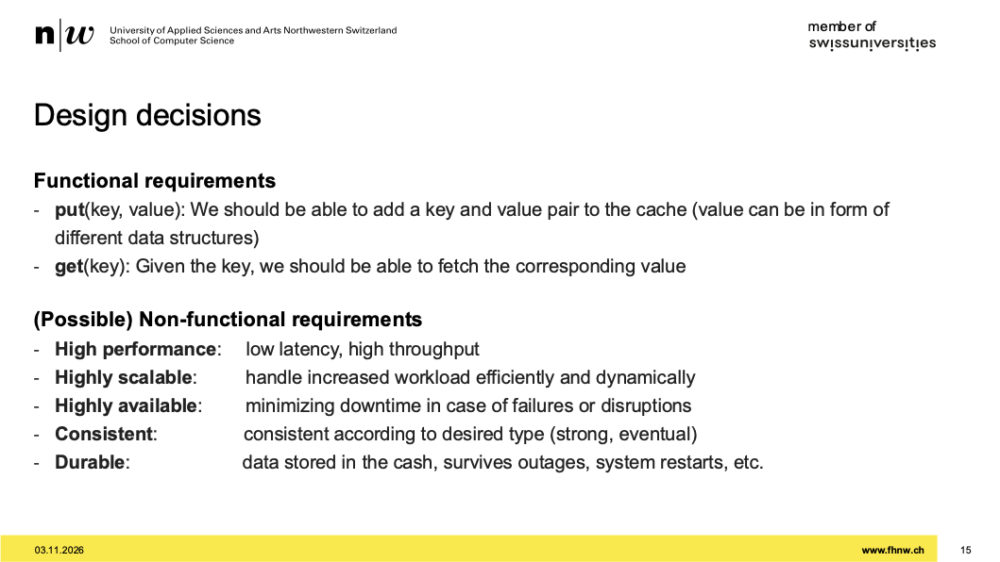
- funktional: put und get haben
- n. funktional: performance, scalable, available, consistent, durable

## Design decisions – Data types / structures

- überlicherweise key-value-store
- memcached: strings, objects, array
- redis:
  - typischer key-value-store
  - redis selber verschiedene datenstrukturen
- hazelcast:
  - [hazelcast](https://docs.hazelcast.com/hazelcast/5.5/data-structures/distributed-data-structures)

## Topologies - Co-located (embedded)

- 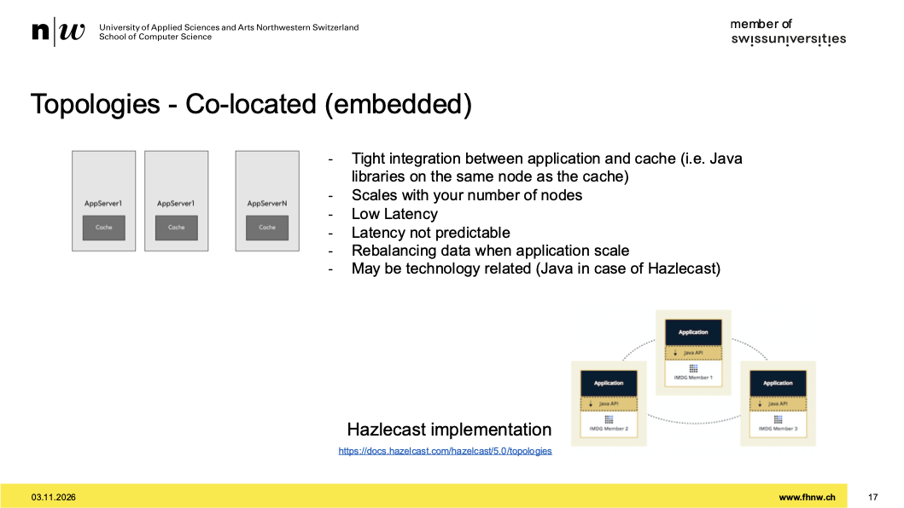
- cache in nodes die ich habe, hat jeder node einen caching-anteil eingebaut
  - skalierung problem, nur so viel wie nodes gross sind
  - entkoppelung fehlt
  - häufig als app-cache

## Topologies - standalone (client/server)

- 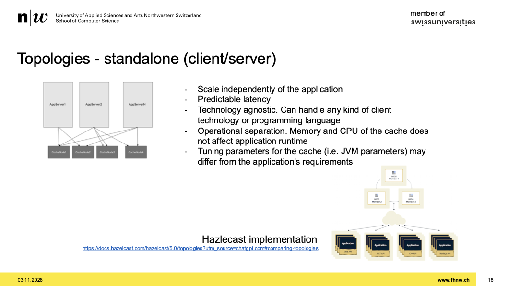
- dedizierter cache
- ein system nur für caching bauen
- unabhängig von technologie der app

## How distributed caches scale - Partitioning

- 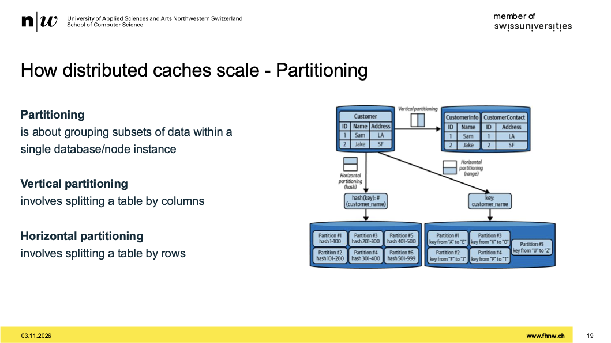
- wie skaliert ein cache?
  - ein grund ist partitionieren
  - damit es schnell geht, ist cache partitioniert
  - man kann partitionen konfiguieren und einstellen
  - es gibt partitionen
  - sind in verschiedene blöcke in einem node vorhanden
  - dadurch kann man parallele anfragen laufen lassen
  - wahrscheinlich wird es aber nach buchstaben nicht so ausgeglichen sein
  - nach welchem key bauen wir caching auf? wie wird es verteilt?

## How distributed caches scale - Sharding

- 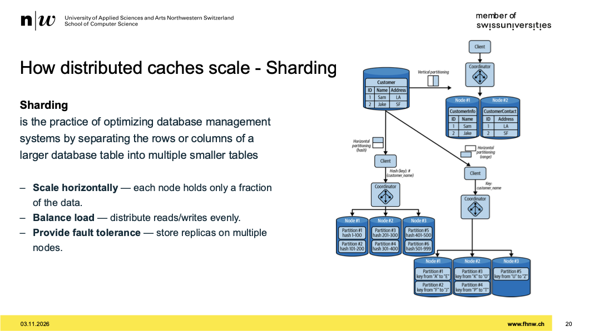
- wie partitionieren wir über mehrere nodes?
- sharding heisst, partitionen auf verschiedene nodes zu haben

## How distributed caches scale –hashing

- 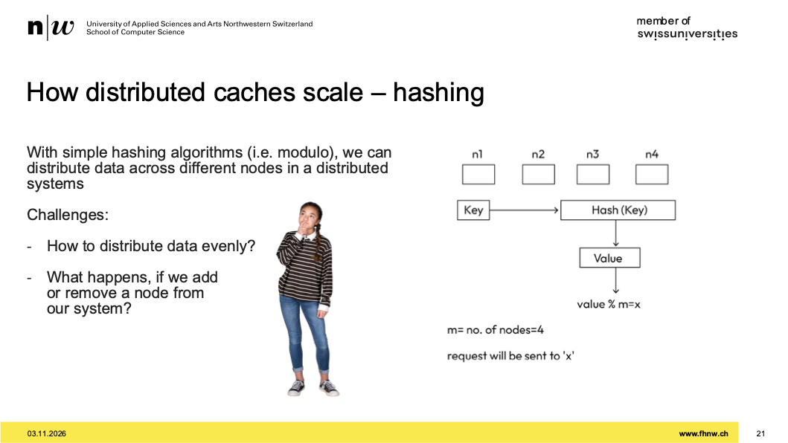
- den hash probieren zu optimieren

## How distributed caches scale –consistent hashing

- 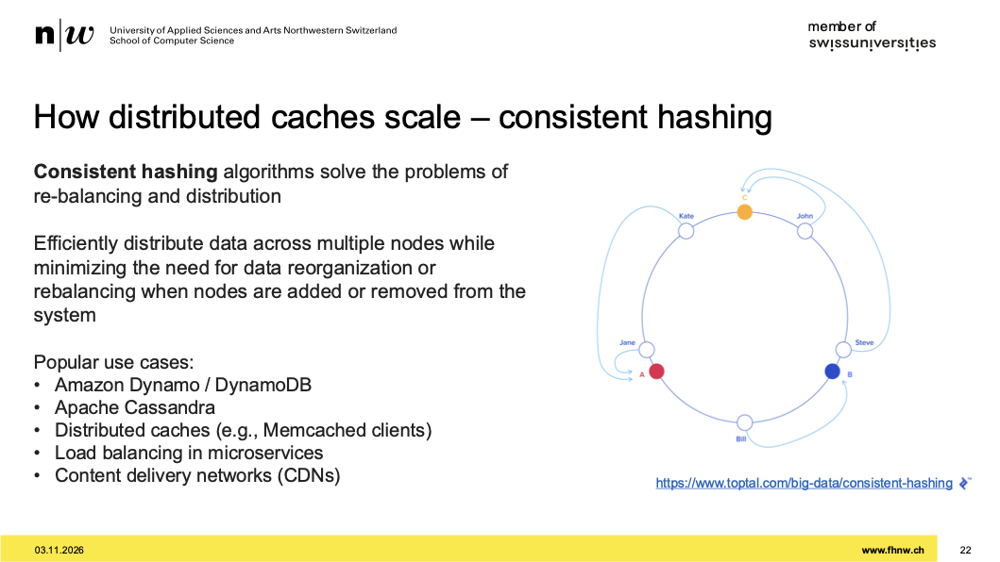
- dieser algo für effizientes hashing
- hazelcast kann auf azure konfiguriert werden bezüglich skalierung

## Caching strategies – lazy loading

- 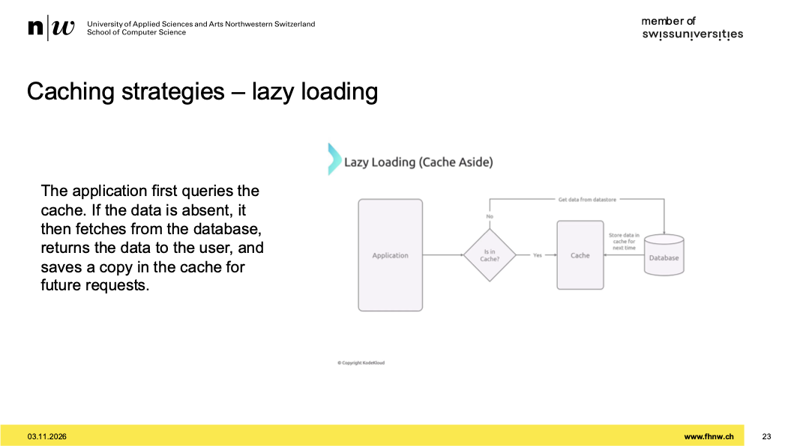
- eine anfrage kommt
- cache wird gefragt, ob antwort im cache ist
- wenn nicht direkt zur datenbank

## Caching strategies – read-through

- 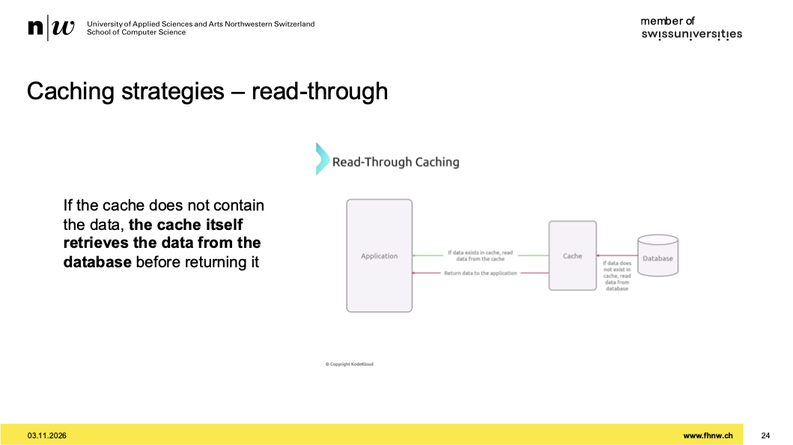
- der cache selber reagiert als entscheidungsträger
- wenn nicht im cache, macht er selber datenbank und speichert es sich ins cache dann
- beispiel ist ein imageregistry
- cache muss mit quellsystem reden können

## Caching strategies – write-through

- 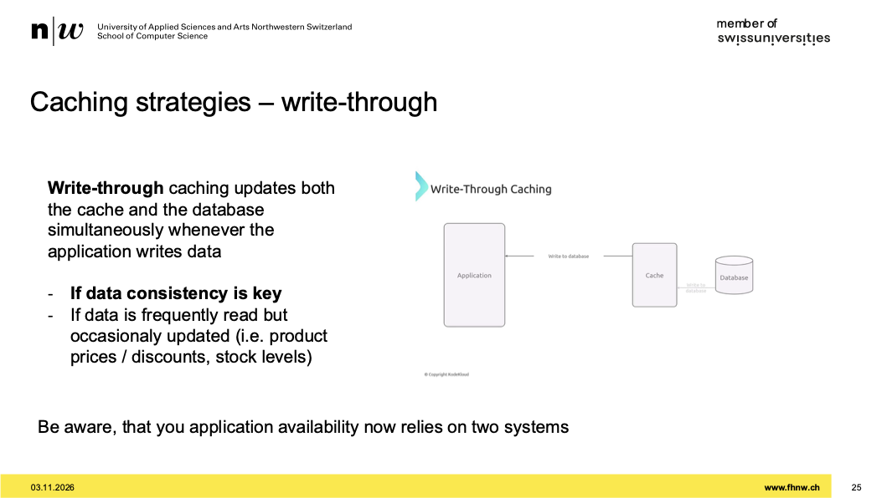
- in dieser methdoe ist consitency vorhanden
- wenn db geupdated wir, wir auch daten im cache geupdated
- wenn solche systeme gebaut werden, mit cache dazwischen etc ist die nächste slide wichtig

## About high availability levels

- 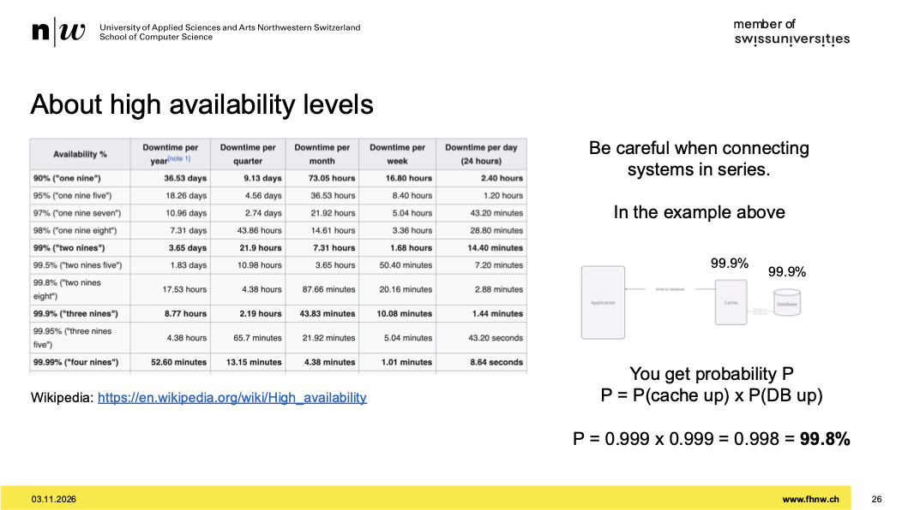

## Keep it clean – cache invalidation

- 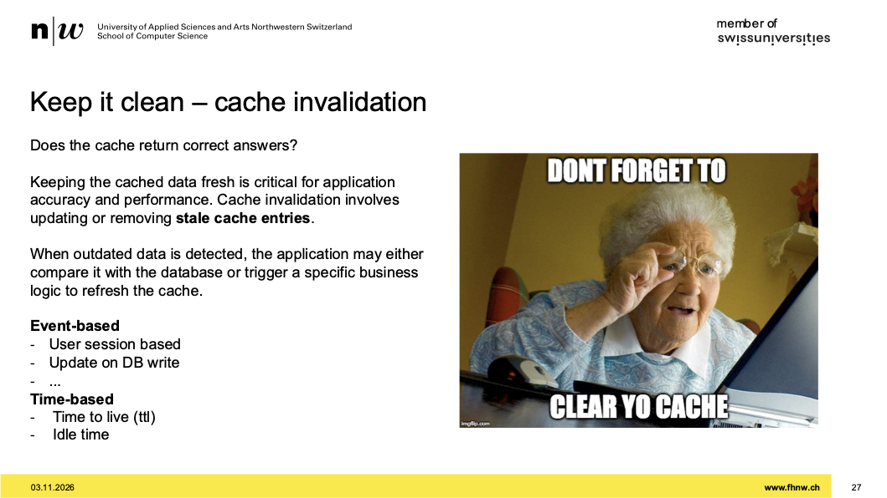
- entries die nicht mehr gebraucht werden
- wenn user sich ausloggt, soll ich cache reinigen -> event based
- wenn event-based nicht vorhanden, dann time-based
  - time to live (ttl)

## Triggered clean-up

- 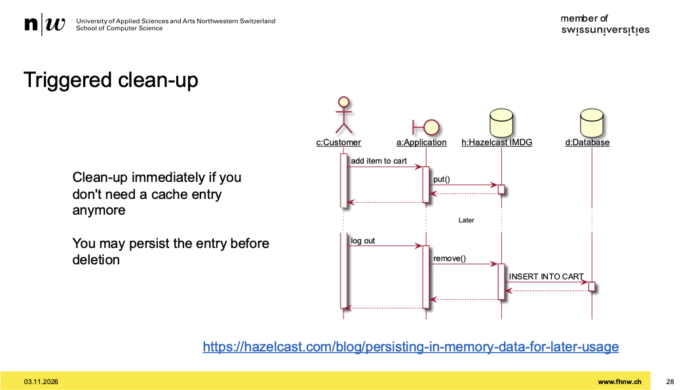
- vielleicht persistieren, bevor cache gelöscht wird

## Keep it clean – cache eviction

- 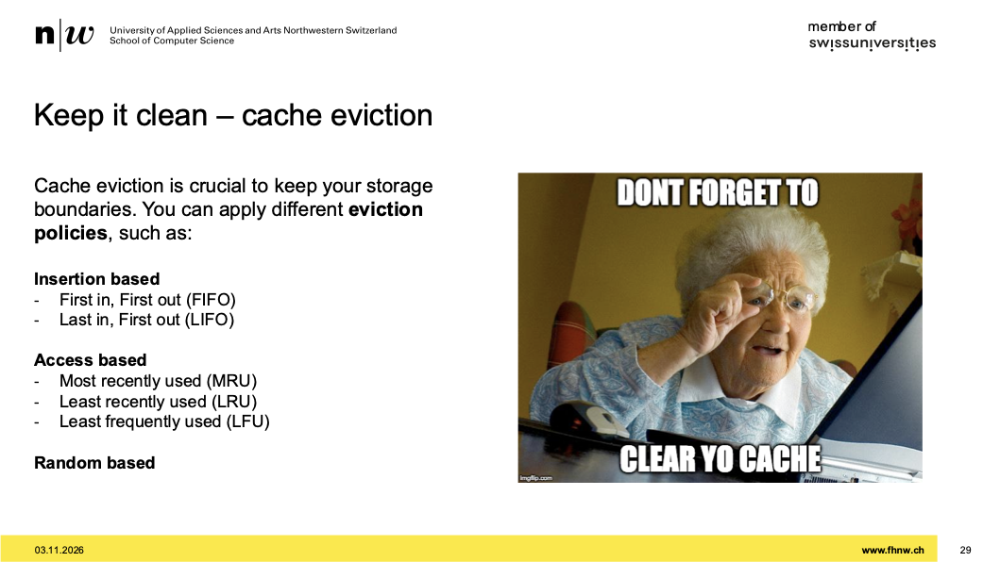
- wir wollen cache immer sauber behalten
- verschiedene policies
- insertion-based:
  - fifo
  - lifo
- access-based:
  - most recently used
  - least recently used
  - least frequently used

## Cache eviction - LRU implementation

- 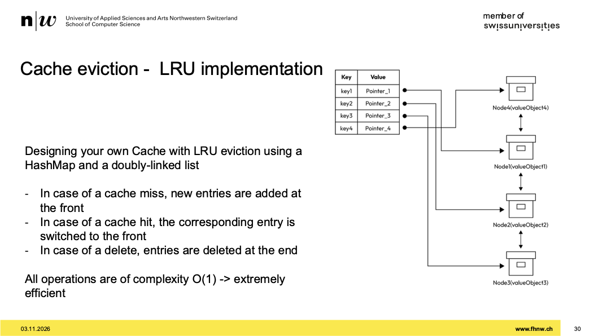
- sehr effizient

## Cache eviction - what products provide

- 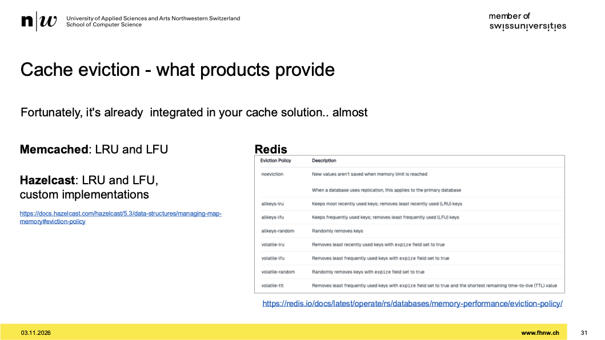

## Observability metrics

- 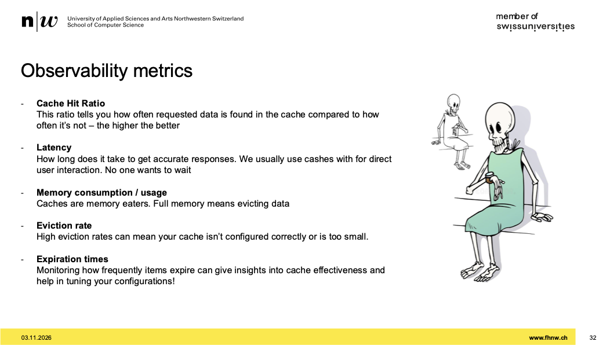
- cache-hit-ration, wie oft im cache ein hit erzielt wird, ober nicht
- zu viele cache misses habe, wird das ganze langsam
- miss heisst, aus source laden müssen
- latenz, wie lange geht es, wenn er aus dem cache kommt
- mem consum, usage, bei cache ist memory ein thema
- memory ist teuer
- cpu ist weniger thema, mehr memory (RAM)
- eviction rate, wie viel wird effektive evicted, wie häufig wird expired
- die oberen drei sind die wichtigen metriken

## Popular cache solutions

- 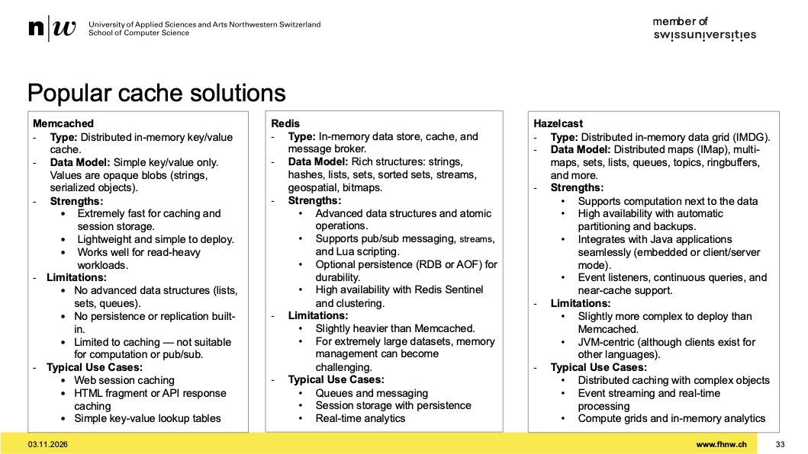
- memcache ist einfache lösung
- redis ist auch etabliert
- hazelcast kommt aus java welt
  - ist komplexer
  - kann gute embedded caches bauen

---

## Assessment 08

- part 1:
  - konzept
  - welche policies haben wir gewählt?
  - was beachten bei policies
  - nicht wie funktioniert ein algo
- part 2:
  - wie funktioniert dht
  - user greifen auf daten von cw
  - cw braucht eine api die daten einfach zurück geben
  - ein cache bauen, der dazwischen sein
  - evential cosistening reicht
  - user möglichkeit geben abfragen zu machen in string form
  - einbisschen die google suche machen
  - nachdem tippen eines buchstaben sollen vorschlag kommen von allen wörtern
  - wie implementieren ist unsere sache
  - der dozent hat einen search-client implementiert
  - in go hat er es gemacht
  - dieser hat zwei endpoints, einmal für cache einmal typeahead
  - wenn cached konfiguriert werden
  - valky verwenden statt redis, wegen opensource
