# Week 09 - Reliability Resilience Patterns

[Drehbuch](https://sgi.pages.fhnw.ch/moduluebersicht/2026hs/sysd/drehbuch.html)
[Aufgaben](https://spd.pages.fhnw.ch/module/sysd/assignments/system-design/index.html)

---

## Abschlussprüfung

- alte themen können fragen gestellt werden
- auf screen werden architekur gezeigt, mit web und db service
  - vlt ein backendsvc
- danach ein text, aufgabenstellung
- anhand problem wie wir es lösen würden
- bsp. mit caching, oder queueing, odr skalieren mit persistenz
- konzeptionell erklären
- kein code schreiben
- konzept abgefragt werden

---

# Reliability Resilience Patterns

## A need for Resilience Engineering

- 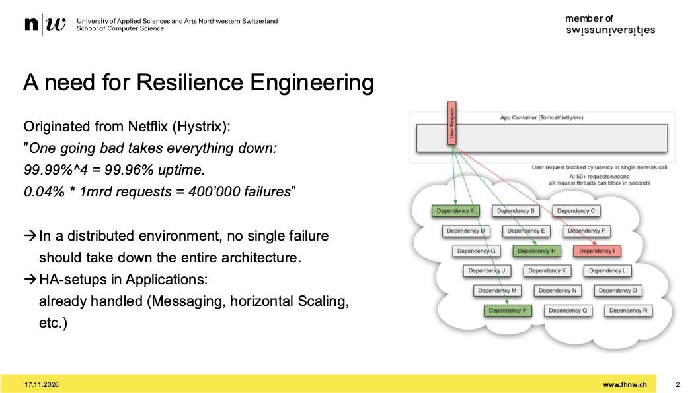
- es braucht alle svc
- wenn ein svc down ist, ist der ganze client svc down
- netflix hat ein framework gemacht
- was tun wenn die fehler auftreteten (die 400'000)
- bei microsvc ist prolematisch
- mit HA wird viel davon gelöst

## Eight Fallacies about Distributed Computing

- 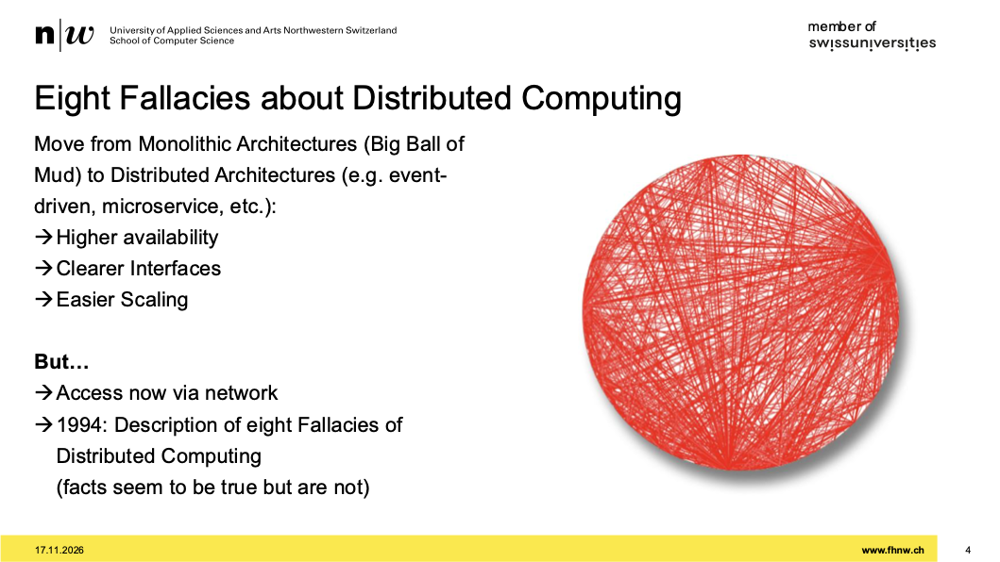
- wie gehen wir an thema heran?
- woher kommt dieses problem?
- früher monolith, heute mehr microsvc
- versprechen an microsvc ist folgendes:
  - availability erhöhen
  - svc voneinander trennen
  - einfacher skalieren
- aber:
  - acess wie network
  - wir arbeiten im verteilten netz
  - es gibt ein buch
- beim monolith gibt es keine latenz, also nur auf CPU und RAM zugreifen

## Eight Fallacies about Distributed Computing “Latency is zero”

- 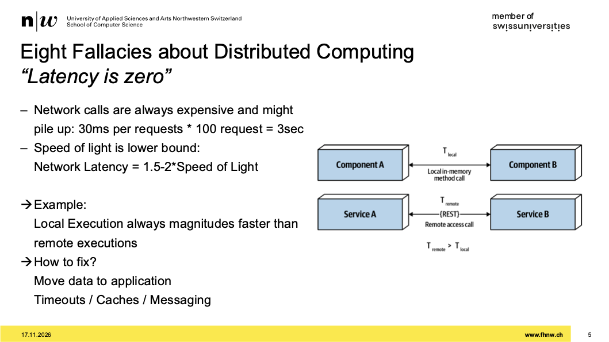
- im distributed gibt es latenz
- latenz verbessern durch caching, messaging, timeouts
- netzwerklatenz ist 1.5-2*lichtgeschwindigkeit und das ganze 2 mal wegen hin und zurück
- bei grossen distanzen ist latenz problem

## Eight Fallacies about Distributed Computing “The network is reliable”

- 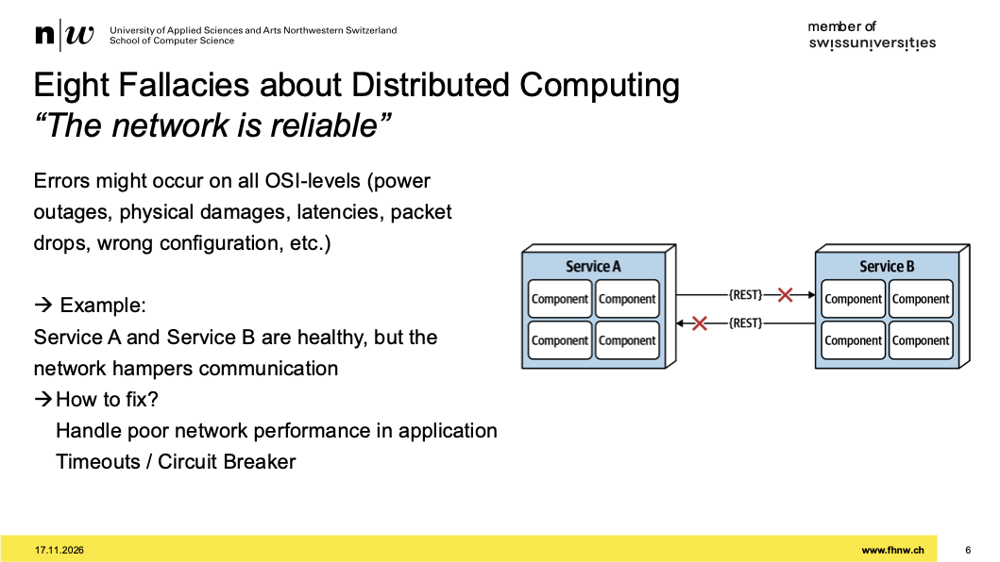
- monolith hat keine kommunikationsprobleme
- im netzwerk haben wir immmer irgendetwas das ausfällt
- umgehen durch Timeout odr circuit braker

## Eight Fallacies about Distributed Computing “Bandwidth is infinite”

- 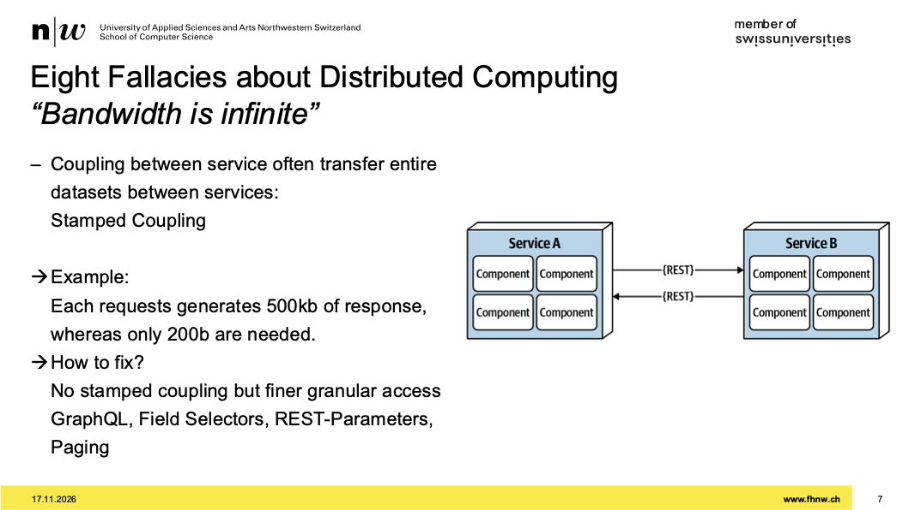
- siehe beispiel was problem ist und lösung
- paging, nur einen teil der daten zurückgeben

## Eight Fallacies about Distributed Computing “Network is secure”

- 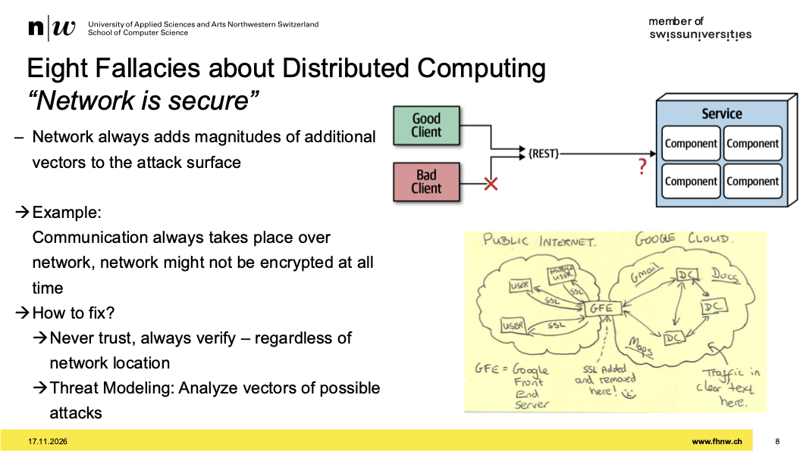
- bei monolith weniger problem
- bei microsvc immer davon ausgehen, dass jemand mithört quasi
- security im verteilen umfeld war einfach
- früher zwibelmodell genommen, mit schalen
- äussertste schale ist access zone, server und so direkt vom interne erreichbar
- dann innere schale, backend svc, geschütz, nicht ovn internet erreichbar
- zu innnerst, db svc, data zone, nicht man von access zone erreichbar
- allen hin drin wird vertraut, also jeder svc in der selben zone vertraut sich
- es wird immernoch so gearbeitet
- es ist nicht schlecht so
- zwischen zonen gibt es firewall
- man sollte das die svc innerhalb von einer zone auch nicht vertrauen
- bei banken werden die svc innerhalb der zonen auch nicht vertraut
- im bereich zero trust, braucht es keine schichten quasi
- ein system, und jeder svc schützt sich

## Eight Fallacies about Distributed Computing “The Topology Never Changes”

- 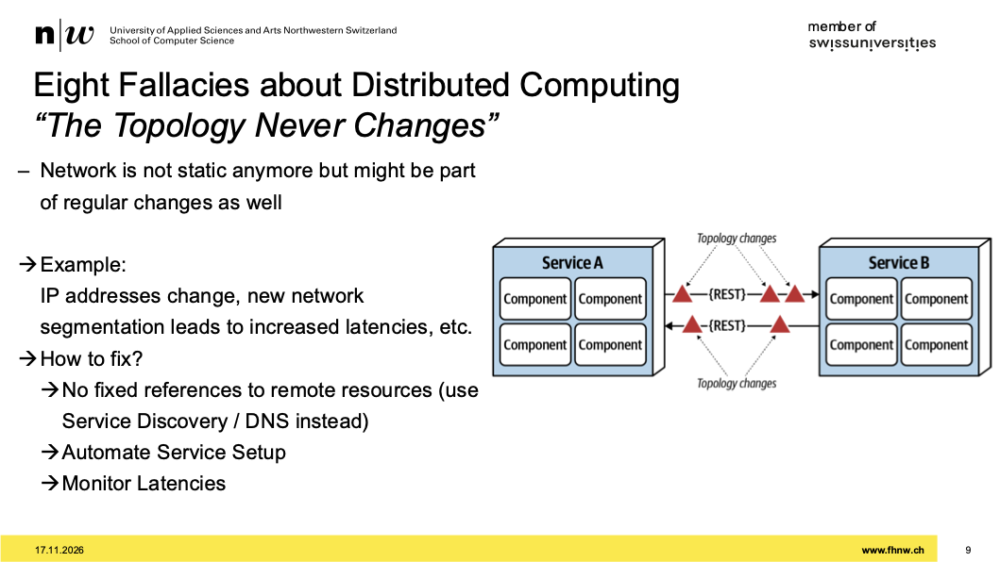
- in praxis wird zu wenig beachtet
- heute baue ich, morgen ist es veraltet

## Eight Fallacies about Distributed Computing “There is only one administrator”

- 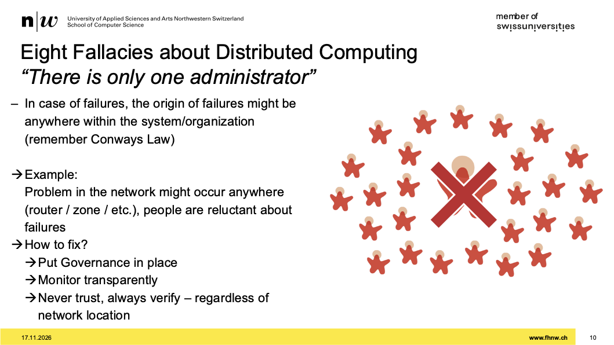
- 1pp svc 100 admins
- die governance ist komplexer
- conways law ist wichtig
  - company organisation widerspiegelt sich in applikation

##  Eight Fallacies about Distributed Computing “Transport Cost is Zero”

- 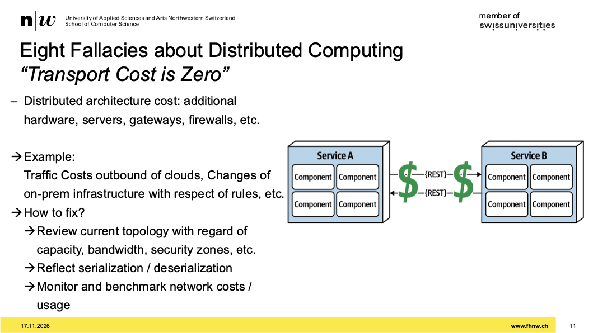
- transport von a nach b kostet in monolith nicht
- bei verteileten systemen kostet so etwas immer
- in der cloud kostet so gut wie alles, was wir über die leitung senden
- bsp. aus der praxis:
  - bei letzetn kunden ein data-mesh in azure gebaut
  - aufgabe war es hoch sicher zu machen und nach domain driven design
  - ein datamesh, dort drin eine applikation wo daten von anderen svc hostet
  - jede app hat eigene blobstorage
  - dieses sind auf eigene geschütue bereiche
  - jeder blob hat einen privaten endpoint
  - im poc perfekt funktioniert
  - im reallife sind die kosten explodiert
- leitung kosten

## Eight Fallacies about Distributed Computing “The Network Is Homogeneous”

- 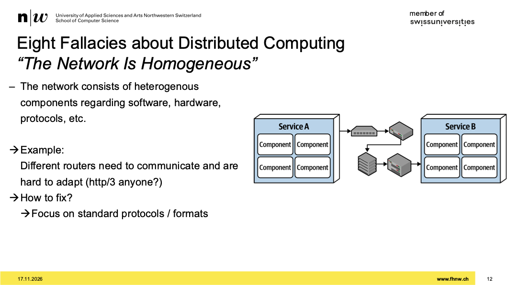
- angefngen bei ipv4 und ipv6
- http1 und http2 aber keiner nutzt http3
- das netzwerk ist hetero
- fixen durch standard protokolle
- reminder für verteilte systeme
- architektur und governance fragen mit denken

## Bonus Fallacies about Distributed Computing

- 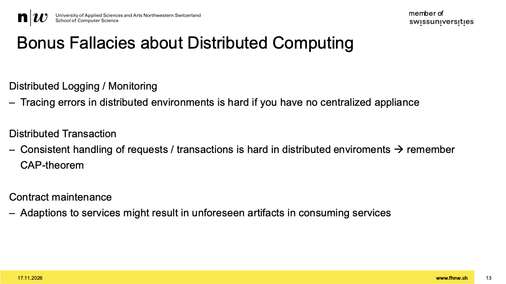
- keine rückwärts kompatiblen API calls
-

##  Where to build in resilience?

- 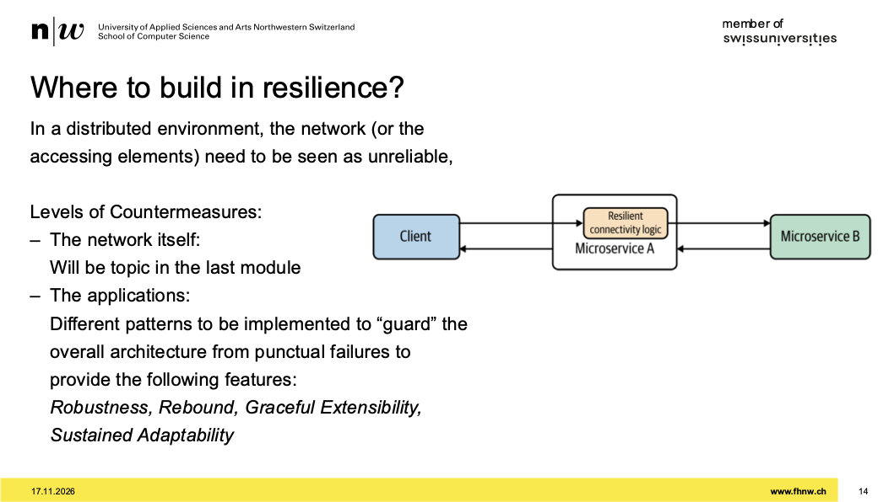
- mit svcmesh kann man das implementieren
- oder in der app mit verschiedenen patterns

## Four concepts for resilience according to Woods

- 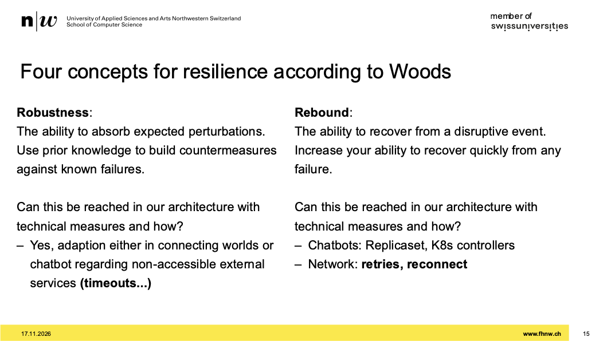
- in vier teile unterteilt
- teil 1, robustness
  - bei ausfall, und latenz kann man mit timeouts arbeiten
  - mit unterschiedlichen applikatorischen massnahmen robustness einbauen
- teil 2, rebound
  - fail early
  - gewisse rebounds haben wir mit k8s selber
- 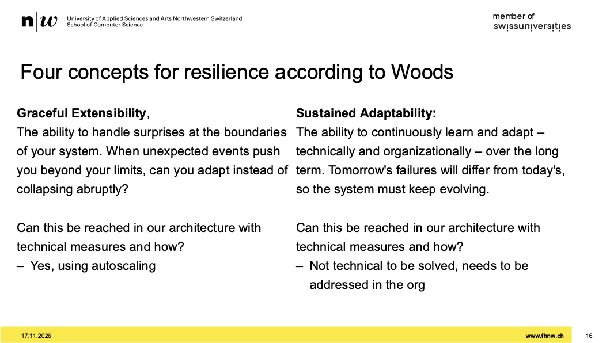
- teil 3, Graceful Extensibility
  - wie behandle ich surprises bei unseren systemgrenzen
  - ungenutzte ressourcen herunterfahren
- teil 4, Sustained Adaptability
  - organisatorische massnahmen
  - daraus lernen
  - system muss evolven

## Pattern: Timeout

- 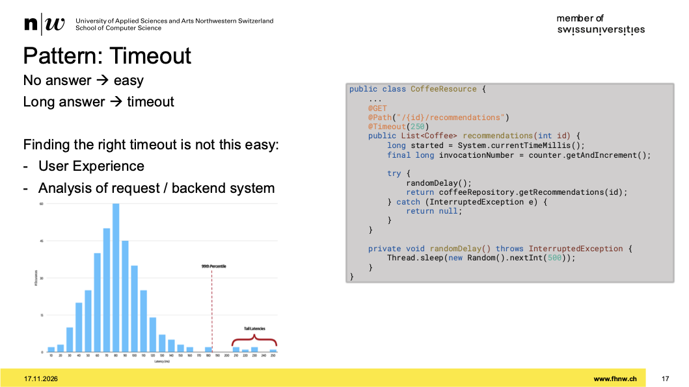
- das richtige timeout finden ist wichtig
- timeout kann man bei eliza einbauen per quarkus annotation
- man probiert im rechten teil der glockenkurve einen timeout zu setzen
- mit mehr erfahrung latenz beachten nicht einfach pi mal daumen
- nicht zu lange warten

## Pattern: Timeout Propagation Timeout in Call Chains

- 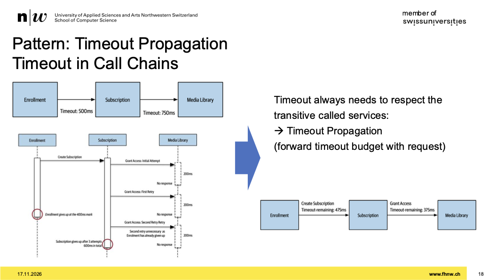
- das akkumuliert sich
- jeder svc akkumuliert sich nach hinten zu den svc
- ein timeout budget nach hinten programmieren
- also ein total und dass über alle svc nicht überschreiten
- in der kette von verteilten systemen ist das schwer

## Pattern: Retry

- 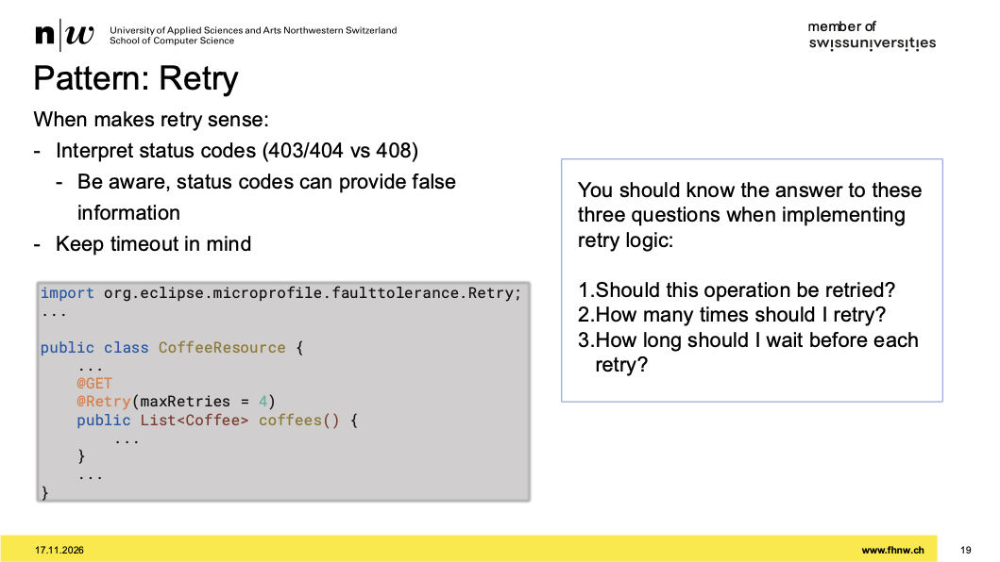
- svc zu svc aufruf in der regel
- a ruft b auf
- a retryt, bei b häufen sich anfragen -> nicht gut
- http statuscodes beachten und intepretieren
- die drei fragen rechts sich stellen

## Safety Rules when working with retries

- 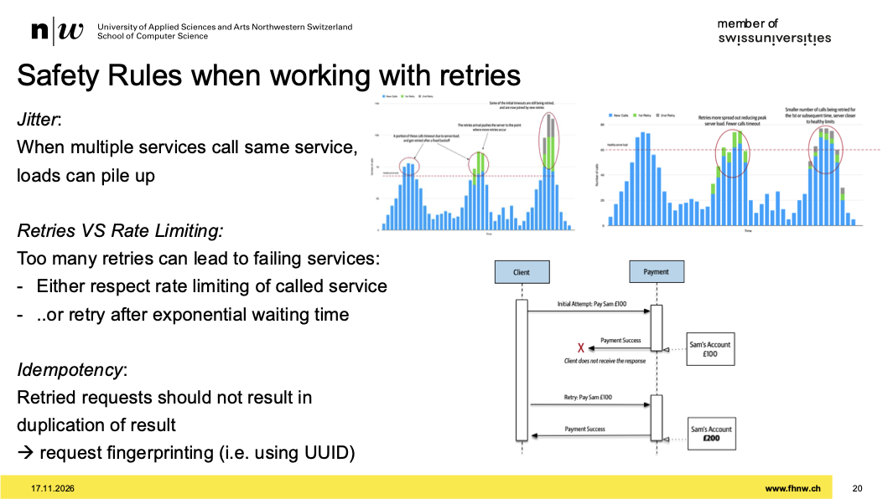
- jitter einbauen
- retries limiten
- idempotenz sehr wichtig
- bei banküberweisungen wichtig
- man kann mit uuid arbeiten

## Pattern: Bulkhead

- 
- ein pool mit limiten mit beschränkten requests
- kommt vom schiff bau
- eine trennung von verschiedenen fachlichkeiten
- in verschiedene use cases trennen

## Pattern: Load Shedding

- 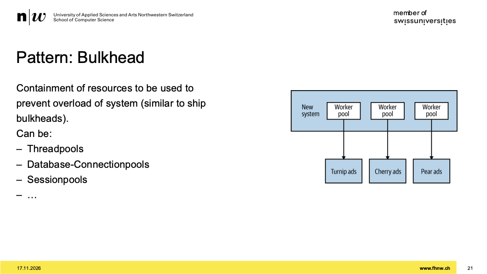
- server kann sich selber schützen bei zu vielen anfragen
- anhand des loads auf dem backend schützen
- bei load sheding anhand des loads und nicht anhand requests
- durch backpreassure an client zurück senden
- durch load shading schützt sich backend server selber bei zu vielen aufrufen

## Circuit Breaker

- 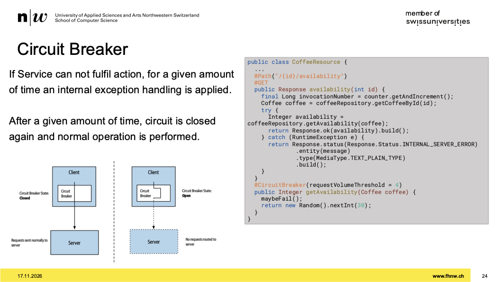
- client schützt sich mit circuit breaker
- wenn er bsp. 2 mal fehler bekommt, haltet er einfach für 5 sekunden und erst dann probiert er wieder

## Circuit Breaker, Culprit

- dieses breaker können sich anhäufen, wenn wieder offen dann wieder alles auf einmal
- gedanken machen wie damit umgehen
- bisschen prb bei breaker, wie damit umgehen, wenn circuit wiededer geschlossen wird

## Instead of Circuit Breaker → Throttle

- 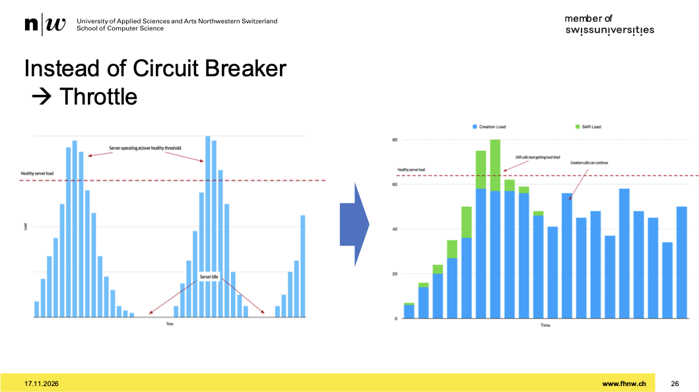
- statt harten cut, können wir drosseln
- wir können priorisieren
- lastspitzen brechen

##  Pattern: Leaky Bucket Rate Limiting

- 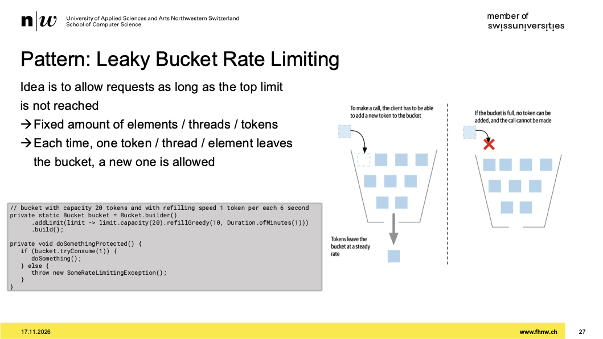
- unten geht regelmässig raus
- bulk emails in bucket reinpacken
- danach sagen jede minute 100 versenden, und nicht 1000 auf einmal
- nginx limit request funktionieren so
- shopify api nutzt das auch

## Assessment 10

- part1:
  - die patterns nochmal reviewen
  - gedanken machen wieso welche einsetzen
  - wir müssen es nicht selber machen, frameworks nutzen
- part2:
  - ein par ausgewählte patterns nutzen, implementieren
