# Week 10 - Reliability Chaos Engineering

[Drehbuch](https://sgi.pages.fhnw.ch/moduluebersicht/2026hs/sysd/drehbuch.html)
[Aufgaben](https://spd.pages.fhnw.ch/module/sysd/assignments/system-design/index.html)

---

## Recap Assessment 10

---

## Recap: Reliability is the most important feature

- 

## Chaos Theory and Butterfly Effect

- 

## Motivation of Chaos Engieering

- 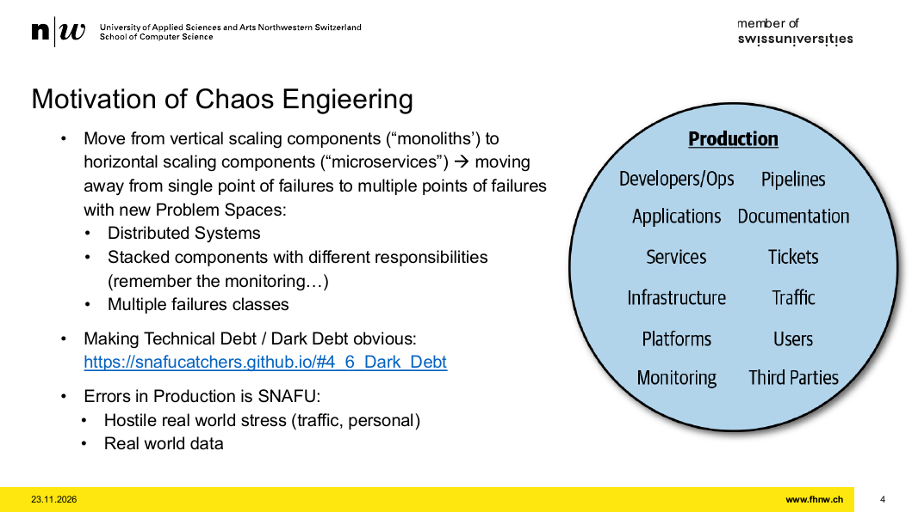

## Classical Testing does not scale

- 

## Correlation Space

- 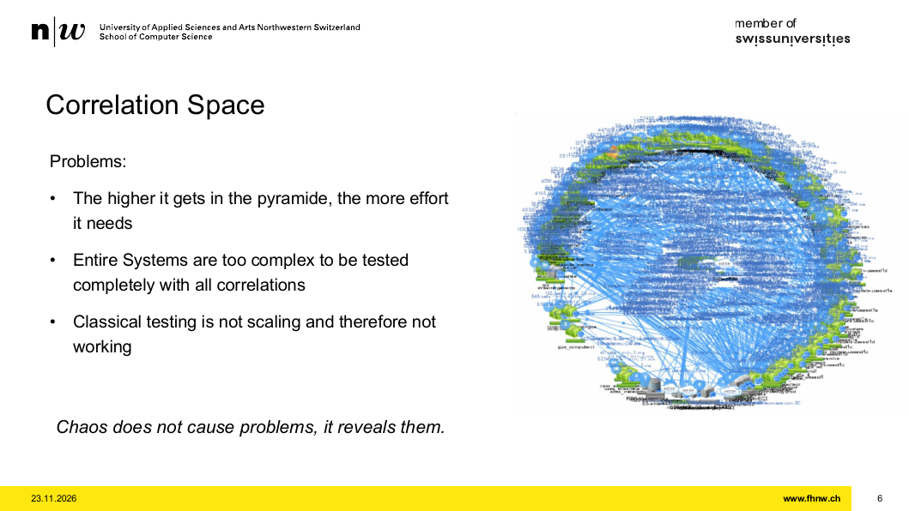

## Example for non-testable error

- 

## Definition of Chaos Engineering

- 

## Tests VS Experiments

- 

## Focus of Experiments

- 

## Workflow of Chaos Experiments

- 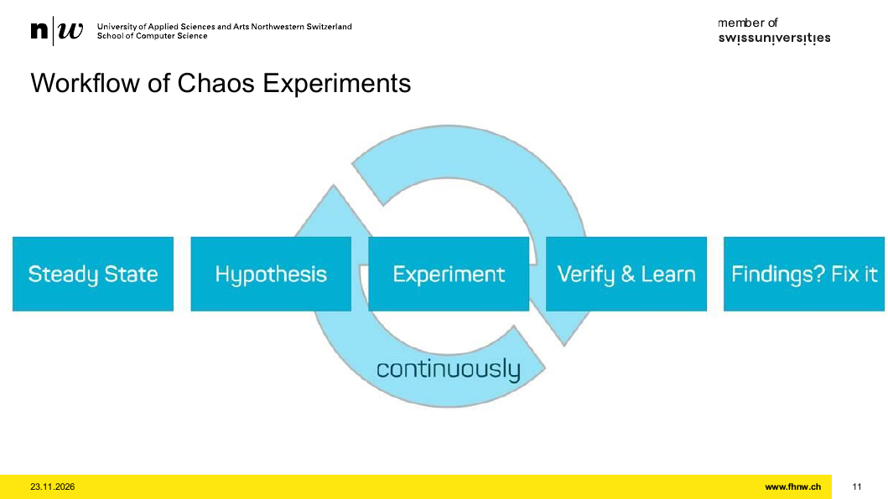

## Define Steady State

- 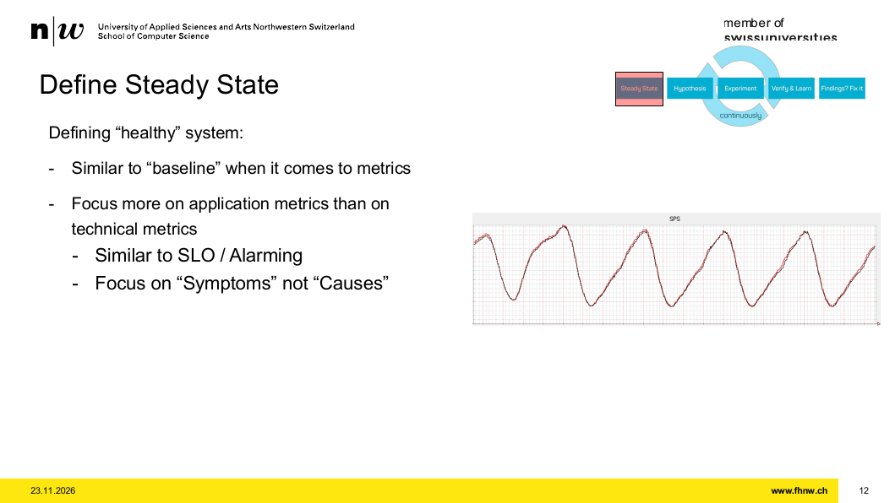

## Steady State in Architecture?

- 

## Form a Hypothesis

- 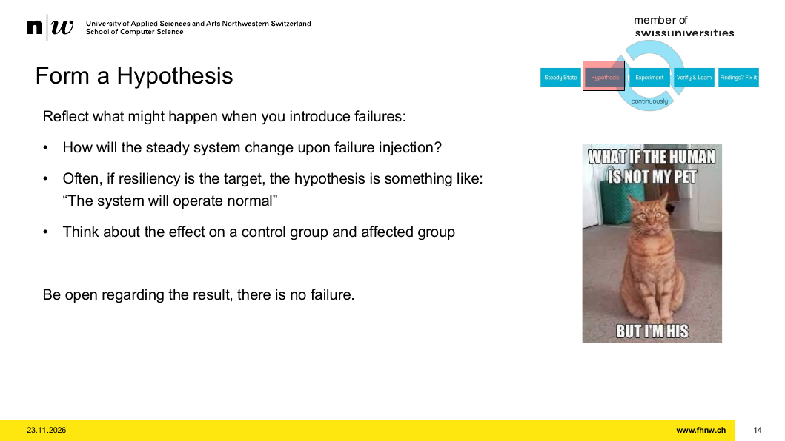

## Hypothesis in Architecture?

- 

## Introducing Failures

- 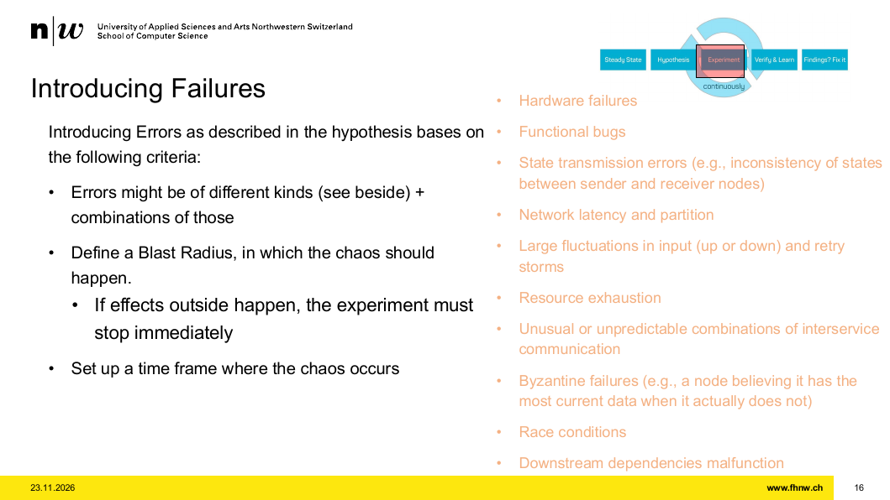

## Verifying Results and fixing issues

- 

## Advanced Principles of Chaos Engineering – Hypothesize about steady state

- 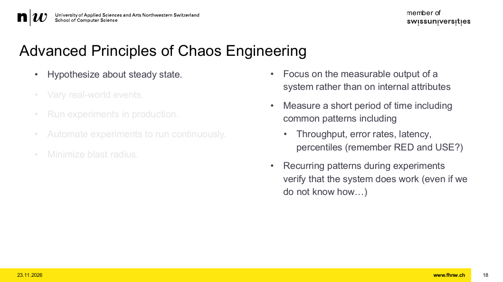

## Advanced Principles of Chaos Engineering – Vary real-world events

- 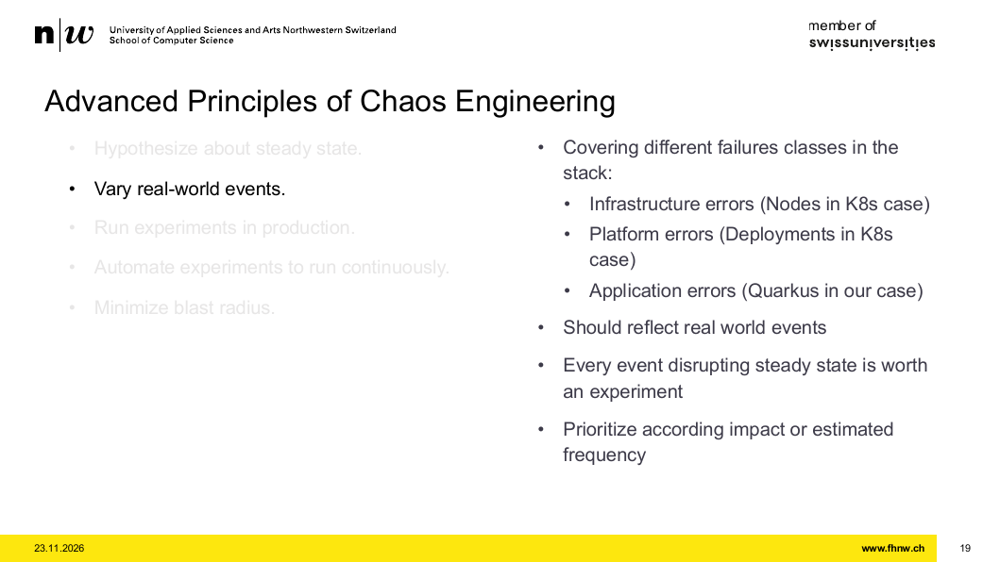

## Advanced Principles of Chaos Engineering – Run experiments in production

- 

## Advanced Principles of Chaos Engineering – Automate experiments to run continuously

- 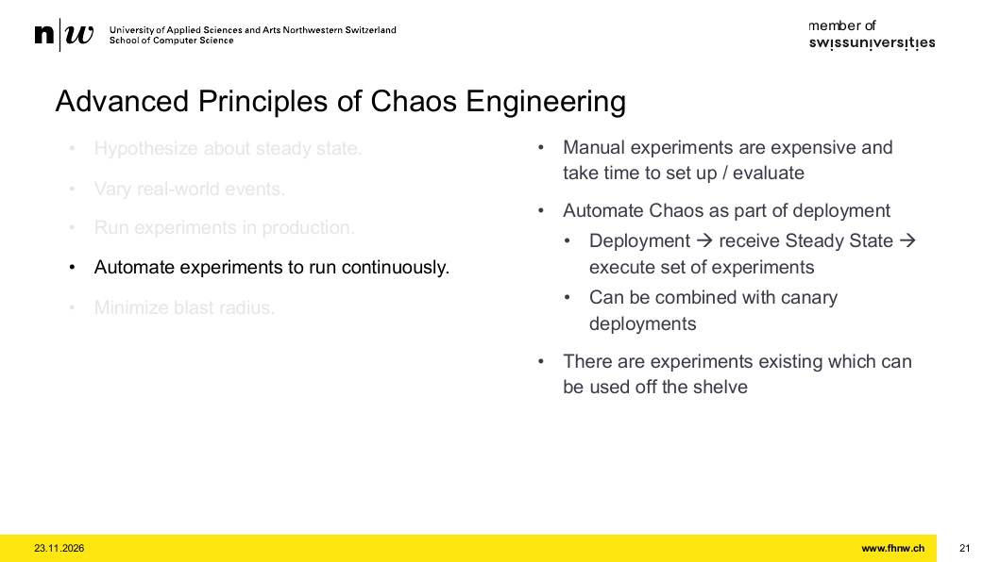

## Advanced Principles of Chaos Engineering – Minimize blast radius

- 

## Example

- 

## Further Examples

- 

## How companies embrace chaos: Netflix’s Chaos Team

- 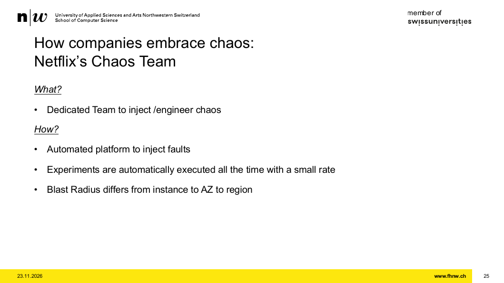

## How companies embrace chaos: Slack’s Disasterpiece Theater

- 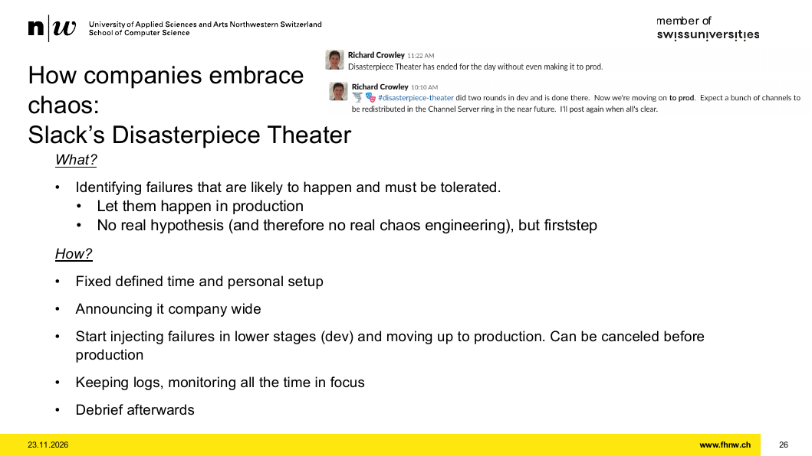

## How companies embrace chaos: Google DiRT

- 

## Tools: Simian Army

- 

## Tools: AWS Fault Injection Simulator

- 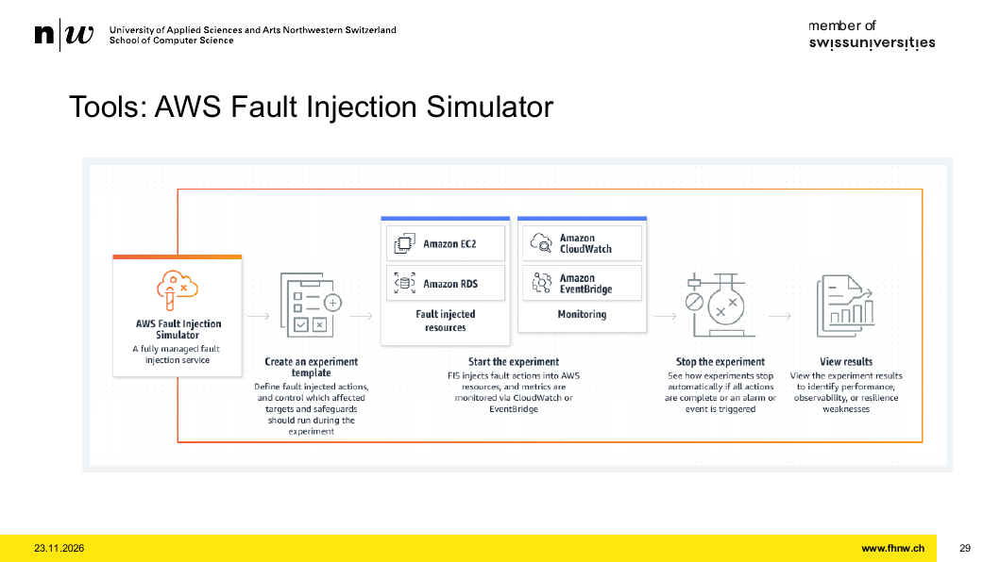

## Tools: Azure Chaos Studio

- 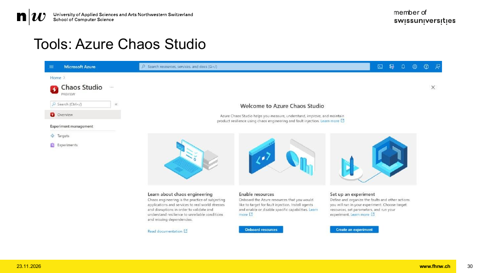

## Tools: Chaos Toolkit

- 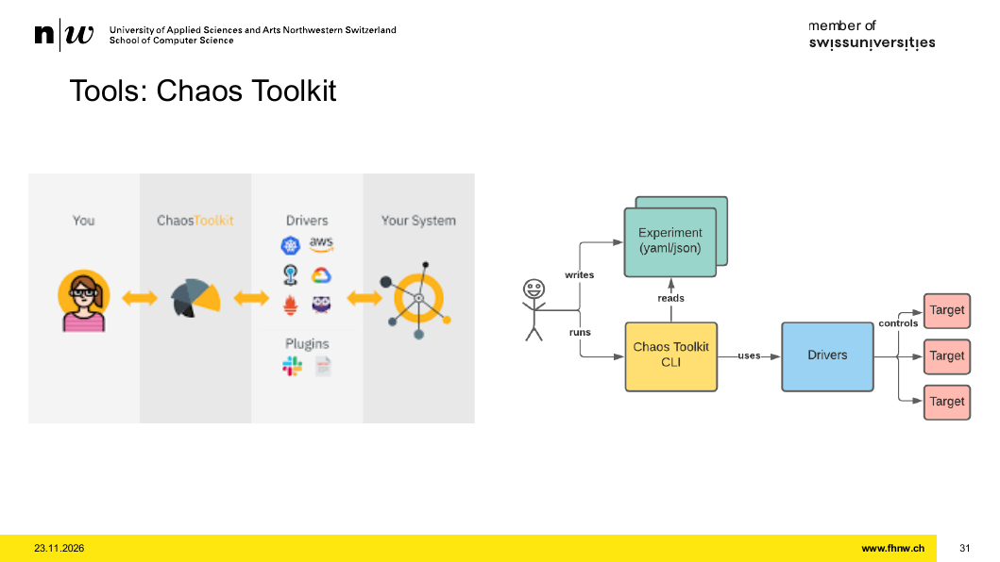

## Tools: Litmus

- 
