# Week 10 - Reliability Chaos Engineering

[Drehbuch](https://sgi.pages.fhnw.ch/moduluebersicht/2026hs/sysd/drehbuch.html)
[Aufgaben](https://spd.pages.fhnw.ch/module/sysd/assignments/system-design/index.html)

---

## Recap Assessment 10

- resilienc pattern meiste pattern sind programmatisch
- welche machen in cw sinn?
  - hello circuit breaker genutzt
  - fallback genutzt
- wie implementiert?:
  - viele pattern in frameworks schon drin
  - bei quarkus gibt es schon eine dependecy: smallrye resilience
  - dependecy: smallrye-fault-tolerance
  - fallback: eine liste von std. antworten, wenn llm service nicht erreichbar, gibt eliza aus diesen antworten einen zurück
  - circuit-breaker: einen zähler, der zählt, wie häufig ein aufruf funktioniert, bzw. fehlschlägt
  - schönes pattern, günstig implementiert
  - annotation @CircuitBreaker
  - wenn in app programmieren, schauen ob es libs gibt, oder support

---

## Recap: Reliability is the most important feature

- 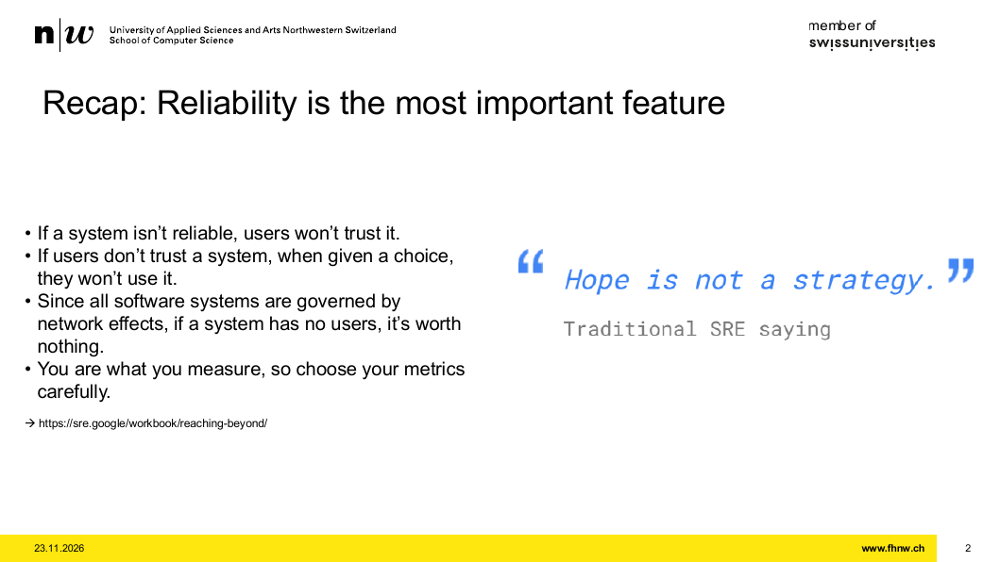
- SRE = site reliable engineering
- man sollte dinge kontinuierlich testen, schauen wie verfügbar sind

## Chaos Theory and Butterfly Effect

- 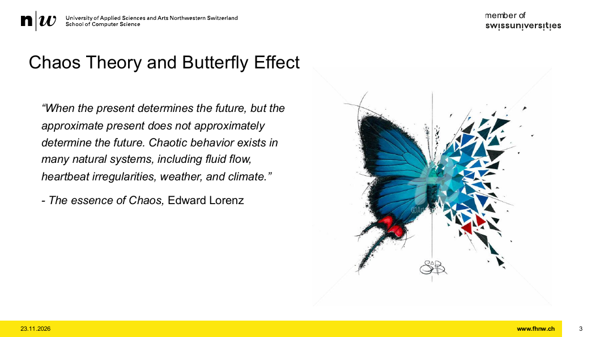
- alles hängt so dermassen miteinander, dass man nicht sagen kann was wie bewirkt
- eine änderung an einem IT system kann unbekannte folgenden haben an einem anderen system

## Motivation of Chaos Engieering

- 
- heute keine monolithen, mehr microservices
- man hat keinen SPF (single point of failure), mehr verschiedenen fehlerpunkte
- technische schuld =
- dark dept = schulden die ich nicht sehe

## Classical Testing does not scale

- 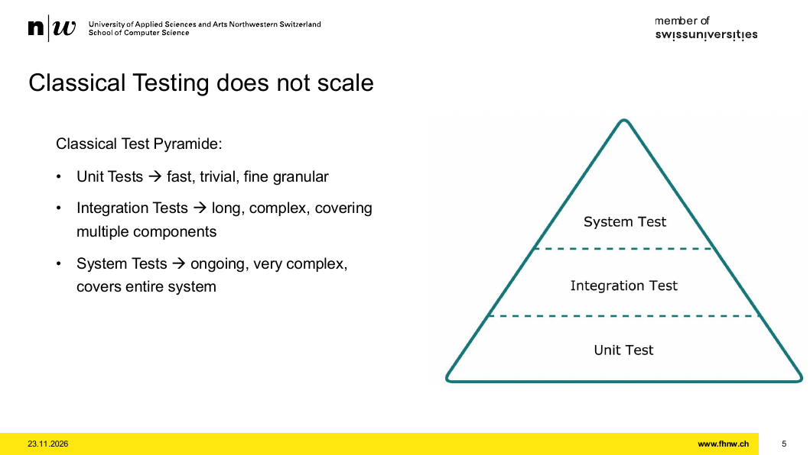
- testen reicht nicht
- mit umsystemen testen = integrationstest
- systemtest, abnahmetest, darunter auch last test

## Correlation Space

- 
- bringt wenig, wenn man so ein system hat
- sehr viele services wo jeder mit jedem redet
- das zu testen muss man regelmässig an baum schütteln

## Example for non-testable error

- 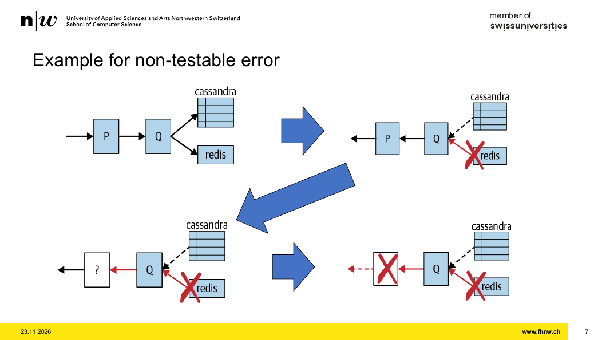
- P und Q sind services
- cassandra ist ein P to P datenbank
- redis bricht weg
- cassandra kann nicht schnell genug liefern
- services bricht weg, anderer service genauso

## Definition of Chaos Engineering

- 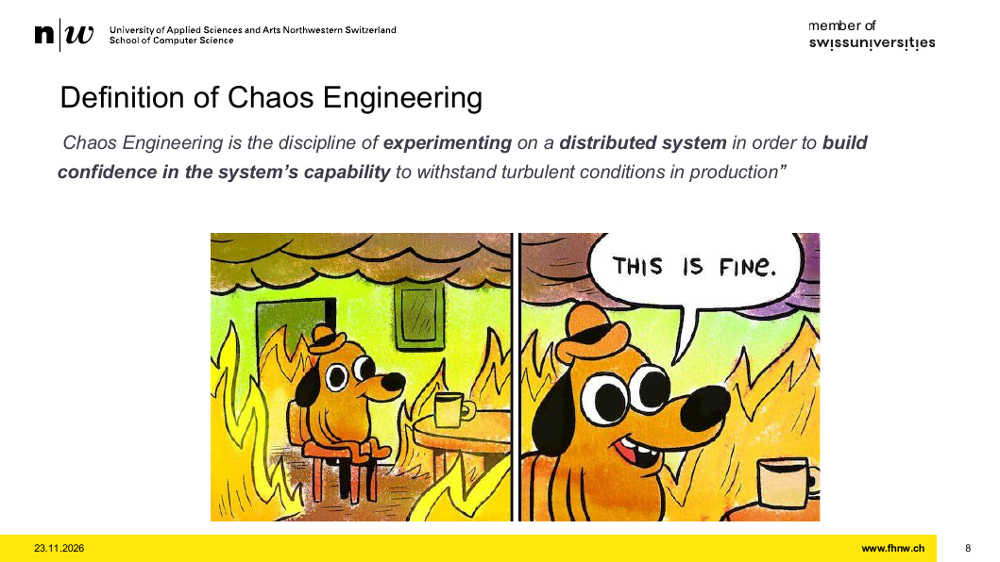
- stellst experimenta auf, machst annahmen und machst eine hypothese
- durch chaos schafft man vertrauen

## Tests VS Experiments

- 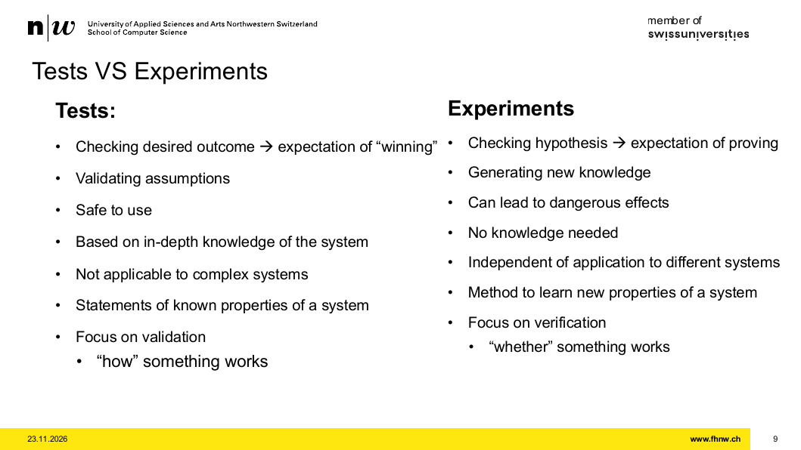
- im normalen testing: income outcome testen
  - annahmen validieren
  - whitebox
- bei chaos:
  - hypthese aufstellen
  - wenn ich db ausstecke, dass passiert xy
  - keine annahme validieren, sondern etwas lernen
  - eine sandbox bauen, aufpassen
  - blackops mehr, reinschauen und lernen
  - funktioniert es überhaupt?

## Focus of Experiments

- 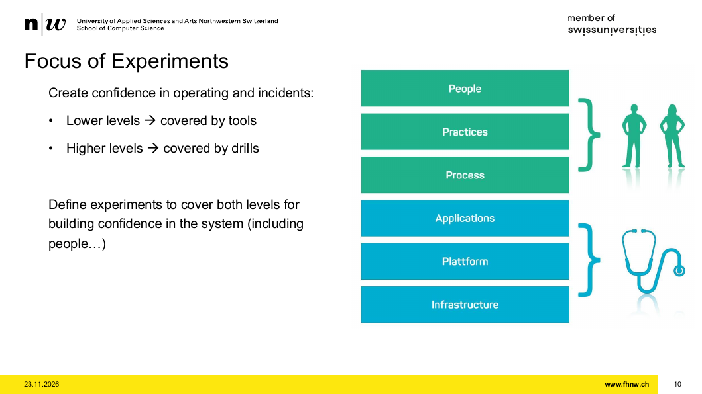
- bei chaos habe ich menschen
- bei tests habe ich tools
- experimente haben flare von firedrill
- auch incidentmanagement testen
- holistisch anschauen

## Workflow of Chaos Experiments

- 
- steady state = status quo

## Define Steady State

- 
- einen gesunden status quo definieren
- was ist gesund?
- ist ein hoher load average schlecht? muss nicht sein
- zu viele prozesse in der warteschlange
- nicht einfach so einen status fest zu legen
- gesund ist mal keinen deploy zu machen, keine hohe requests
- black box testing ist gesund

## Steady State in Architecture?

- 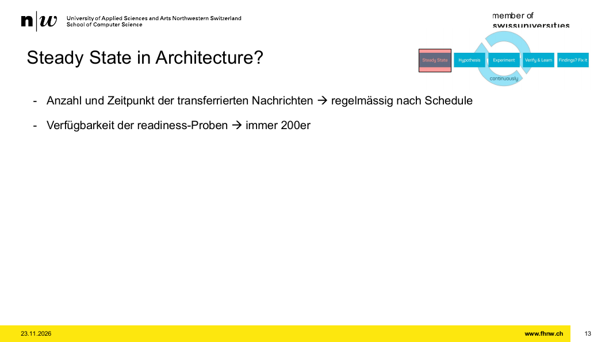
- bei cw:
  - chatbots antworten in vorgegebener zeit
  - chatlog ist innert 1 sekunde abrufbar
  - chatverlauf ist regelmässig innerhalb der vorgegebene zeit
  - chatverlauf semantisch korrekt

## Form a Hypothesis

- 
- wenn das erledigt ist, definiert eine hypothese
- was passiert mit steady state wenn fehler injected werden

## Hypothesis in Architecture?

- 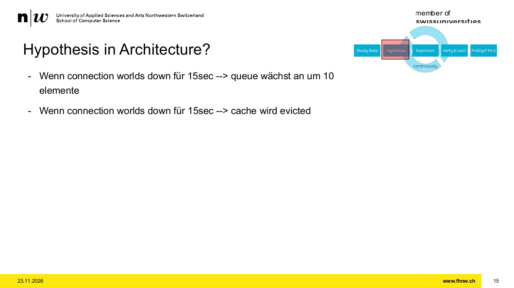
- keine tokens an API, keine antwort
- wenn kein cache brauchen suchanfragen mehr wie 10 sek

## Introducing Failures

- 
- nach hypothese fehler einbauen
- einen zeitrahmen einbauen
- mehr ressourcen verwenden
- irgendwelche kombis an services machen, die so nicht gedacht sind

## Verifying Results and fixing issues

- 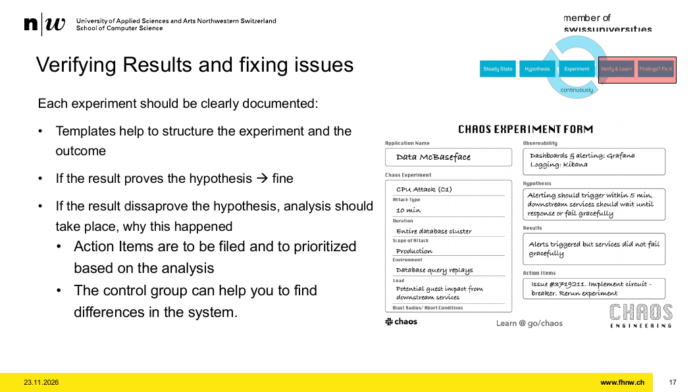
- relativ strukturiert

## Advanced Principles of Chaos Engineering – Hypothesize about steady state

- 
- irgendetwas messbares
- die metriken anziehen, die ich brauche um zu validieren

## Advanced Principles of Chaos Engineering – Vary real-world events

- 
- verschiedene klassen
- infra error die immer passieren können
- events die stattfinden, echte events

## Advanced Principles of Chaos Engineering – Run experiments in production

- 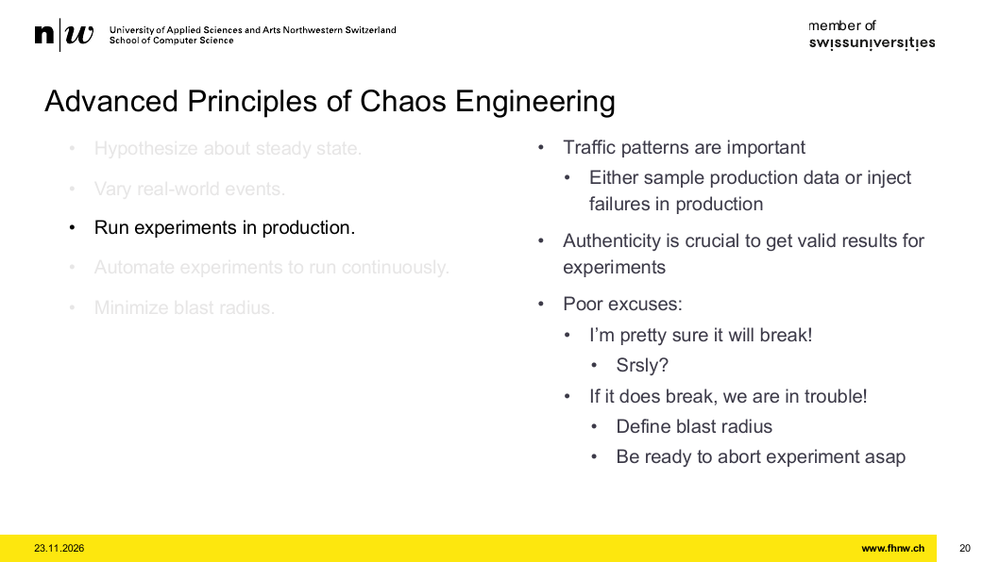
- traffic patterns sind wichtig
- authentisch sein
- fehler im kontrolierten umfeld machen, mit einem sinnvollen blastradius

## Advanced Principles of Chaos Engineering – Automate experiments to run continuously

- 
- so sachen kontinuierlich machen
- sbb 1x pro woche, schmeissen sie regelmässig die workernodes
- so etwas lässt sich mit canary deployment machen

## Advanced Principles of Chaos Engineering – Minimize blast radius

- 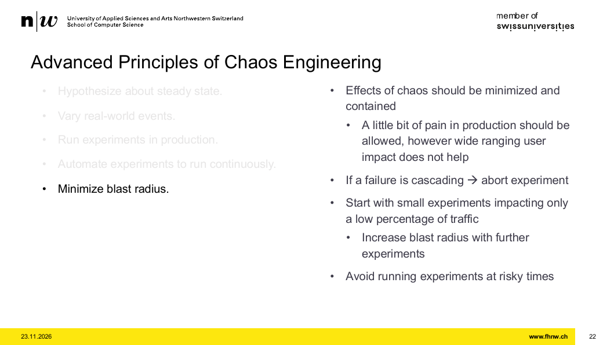
- klein anfangen
- mal ein pod weg nehmen
- so etwas nicht an black friday machen

## Example

- 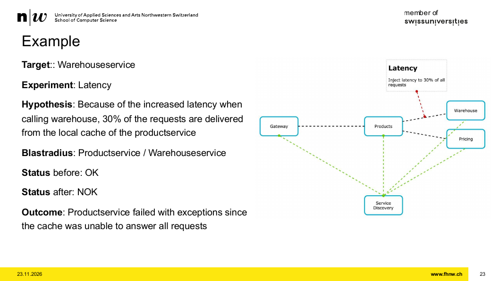

## Further Examples

- 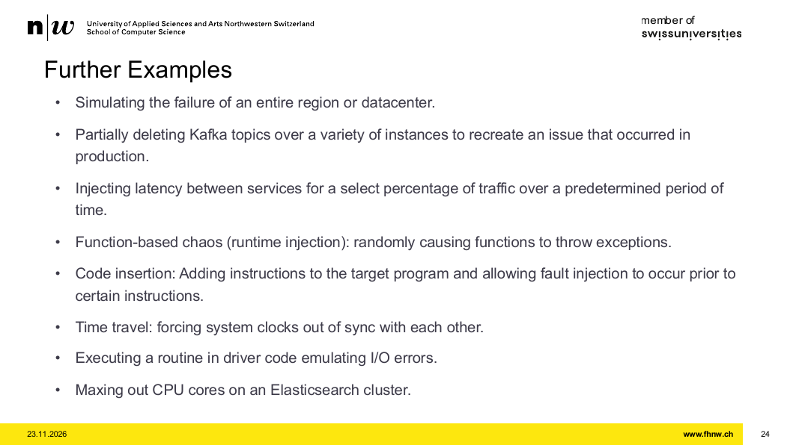
- eine komplette AZ runter nehmen
- beim messaging nachrichten löschen
- funktionen ändern
- was passiert, wenn ich zeit umstelle

## How companies embrace chaos: Netflix’s Chaos Team

- 
- netflix hat das erfunden
- nonstop wird eine kleine menge fehler injected
- somit muss man resilienter werden

## How companies embrace chaos: Slack’s Disasterpiece Theater

- 
- slack macht das unternehmensweit
- sie machen fehler, die hier sein müssen
- bis zu einem gewissen punkt
- danach schauen sie, wo hat es weh getan

## How companies embrace chaos: Google DiRT

- 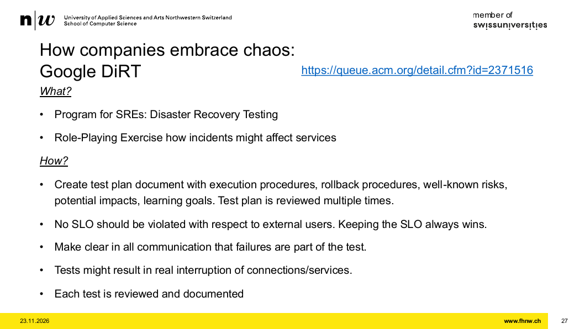
- google nennt es recovery testing

## Tools: Simian Army

- 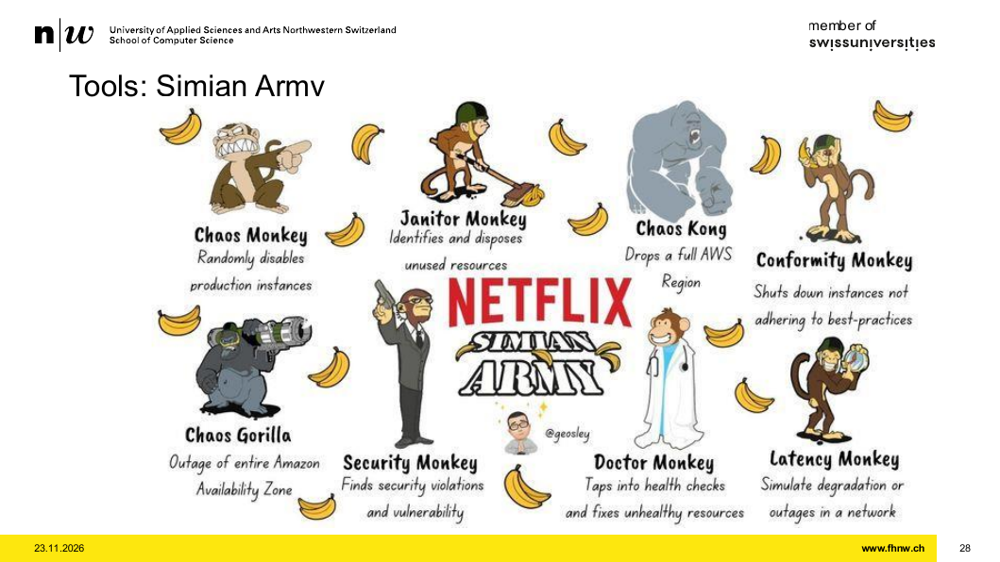

## Tools: AWS Fault Injection Simulator

- 
- hyperscaler hat tools dafür
- aws hat auch einen
- danach hat man auswertung und alles

## Tools: Azure Chaos Studio

- 

## Tools: Chaos Toolkit

- 
- selber implementieren
- mit chaos toolkit
- verschiedene experimente mit yaml odr json definieren

## Tools: Litmus

- 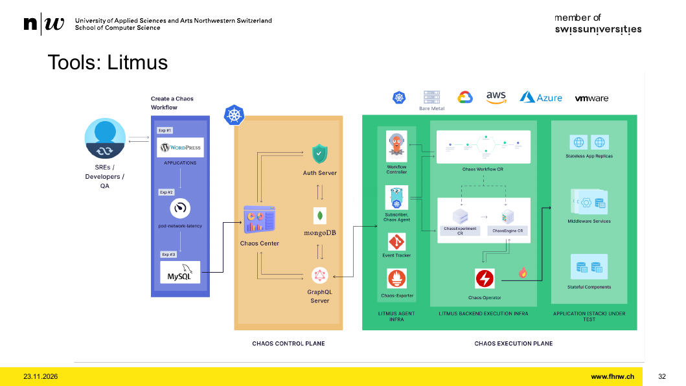
- nativ für k8s
- es gibt eine chaos control plane
- der fängt an sachen herunter zu reissen etc.

---

# Assignement 11

- framework raussuchen
- für unsere architekur
- eine hypthese überlegen/machen
- einen steady state definieren
- danach einfach experimentieren
- so können wir dinge kapput machen
